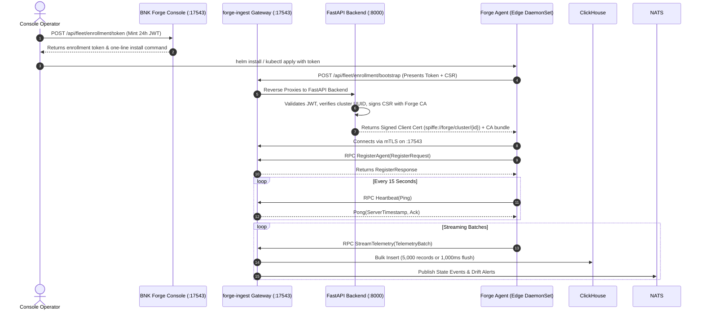

# ACTIVE_CONTEXT.md — BNK Forge PoV Migration

**Last Updated**: 2026-11-16
**Active Branch**: `agent/pov-migration` (repo: `/Users/j.lucia/Code/github/bnk-forge`)
**Completed Milestones**: 
- **Milestone 0**: Localhost Infrastructure Preparation (ClickHouse + NATS + Port :17543)
- **Milestone 1**: Alembic Exit & Atlas Declarative Schema (83 tables baseline + Idempotent Seeds)
- **Milestone 2**: Agent Protocol & Console-Driven Enrollment API (`forge-ingest` Gateway + Backend PKI + UI Wizard)
- **Milestone 3**: Core Forge Agent MVP (`cmd/forge-agent` + eBPF Socket Filter + TMM Harvester + Disk Spool WAL)
**Active Work**:
- **Milestone 4**: Strangler Integration in FastAPI (`ClusterDataProvider` Facade + Agent Heartbeat / State Sync + ClickHouse Telemetry Queries)

---

## 1. Executive Summary

- **Milestone 0 (Completed & Verified)**:
  - Infrastructure baseline established with ClickHouse (`:8123`, `:9000`), NATS JetStream (`:4222`, `:8222`), and Unified Ingest Port `:17543`.
- **Milestone 1 (Completed & Verified)**:
  - All 83 PostgreSQL tables managed declaratively via Ariga Atlas (`backend/schema/schema.hcl`).
  - 162 legacy Alembic migrations archived to `backend/alembic/legacy_v2_archive/`.
  - Idempotent seed runner (`backend/seeds/seed_runner.py`) handling all core entities.
  - Zero DB drift and clean cold-boot test passed.
- **Milestone 2 (Completed & Verified)**:
  - **Wire Protocol & Models**:
    - Protobuf contract: `pkg/proto/forge/v1/telemetry.proto` defining `StreamTelemetry`, `RegisterAgent`, and `Heartbeat`.
    - Pure Go models: `pkg/protocol/models.go` and `pkg/protocol/models_test.go` (100% test pass).
    - Architecture spec: `docs/architecture/AGENT_PROTOCOL_SPEC.md` documenting bidirectional mTLS wire protocol, SPIFFE SANs, batching, and error codes.
  - **High-Throughput Go Ingest Gateway (`cmd/forge-ingest`)**:
    - Built in `cmd/forge-ingest/main.go` and `pkg/ingest/`.
    - Zero-allocation circular memory ring buffer (`pkg/ingest/ringbuffer.go`) with dual-trigger flush (5,000 records or 1,000ms).
    - Native ClickHouse writer (`pkg/ingest/clickhouse.go`) with automated table initialization for `forge.ebpf_socket_flows`, `forge.tmm_dpdk_metrics`, and `forge.ai_gateway_events`.
    - NATS JetStream event publisher (`pkg/ingest/nats.go`) broadcasting agent state transitions and drift alerts to `forge.cluster.{id}.events`.
    - Reverse proxy handler forwarding bootstrap REST routes (`/api/fleet/enrollment/*`) to FastAPI backend over the unified port `:17543`.
    - Docker containerization: Multi-stage `cmd/forge-ingest/Dockerfile` added to `docker-compose.yml` and `docker-compose.local.yml`.
    - Full Go unit test suite (`pkg/ingest/ingest_test.go`): 100% pass rate.
  - **Console-Driven Enrollment & Dynamic PKI Service**:
    - PKI service (`backend/services/pki_service.py`): Generates 10-year root CA and signs short-lived (30-day) agent certificates with SPIFFE SAN `spiffe://forge/cluster/{cluster-uuid}`.
    - Enrollment service (`backend/services/fleet_enrollment_service.py`): Short-lived (24h) JWT enrollment token minting, token verification, and automated Helm/kubectl manifest generation with intelligent LAN/Docker IP self-discovery.
    - Agent endpoints in `backend/routes/fleet_enrollment.py` registered in `backend/main.py`.
    - `backend/core/auth_middleware.py`: Added agent bootstrap routes to `AGENT_PUBLIC_ENDPOINTS` so edge agents can bootstrap without human user JWTs.
    - Full backend test suite (`backend/tests/unit/test_fleet_enrollment.py`): 10 tests passed; regression suite: 41 tests passed.
  - **Frontend UI Wizard**:
    - TypeScript API client (`frontend-v2/src/lib/api/fleetEnrollment.ts`) and React Query hooks (`frontend-v2/src/hooks/useFleetEnrollment.ts`).
    - `AgentEnrollmentWizard.tsx`: Multi-step enrollment dialog offering single-click copy for Helm and kubectl commands, live agent connection polling, and security sequence explanation.
    - `AddClusterFlowDialog.tsx`: Updated to recommend Push-Based Edge Agent as default primary path while preserving legacy direct Kubeconfig option.
    - `Fleet.tsx`: Added "Enroll Agent" button to the action bar.
    - Production Vite build (`npx vite build`) passed with zero errors.
- **Milestone 3 (Completed & Verified)**:
  - **`pkg/agent/transport/`**:
    - `transport.go`: Defines `Transport` and `DiskSpool` interfaces.
    - `http_transport.go`: Implements HTTP/mTLS client for batch streaming (`/api/v1/telemetry/batch`), registration (`/api/v1/telemetry/register`), and heartbeat (`/api/v1/telemetry/heartbeat`). Supports in-memory `RoundTripper` for hermetic testing.
    - `spool.go`: High-performance, crash-safe embedded Write-Ahead Log (`FileDiskSpool`) capped at 500MB with FIFO recovery, atomic fsync commit, and oldest-first eviction.
    - `spooling_transport.go`: Wraps `Transport` + `DiskSpool` to store-and-forward telemetry during network disconnects and auto-drain on reconnect.
    - `transport_test.go`: 100% test pass (`TestFileDiskSpool`, `TestFileDiskSpoolCapEviction`, `TestHTTPTransportAndSpooling`).
  - **`pkg/agent/bootstrap/`**:
    - `bootstrap.go`: Generates ECDSA P-256 key and CSR with SPIFFE Subject; exchanges with `/api/fleet/enrollment/bootstrap` for signed client certificate and Forge Root CA bundle; caches credentials to disk and validates expiry.
    - `bootstrap_test.go`: 100% test pass (`TestAgentBootstrapAndCaching`).
  - **`pkg/agent/ebpf/`**:
    - `observer.go`: Socket observer managing flow channel and metadata enrichment (`ClusterID`, `NodeName`, timestamp).
    - `drift.go`: Day 2 architectural drift detector flagging `TmmBypassViolation = true` when direct inbound traffic to protected ports/namespaces bypasses BNK TMM ingress.
    - `collector.go`: Handles Linux socket tracing with synthetic fallback for unprivileged/local/macOS environments.
    - `ebpf_test.go`: 100% test pass (`TestDriftDetector`, `TestSocketObserverLifecycle`).
  - **`pkg/agent/tmm/`**:
    - `harvester.go`: TMM DPDK Harvester interface and lifecycle coordinator.
    - `reader.go`: Scrapes TMM DPDK metrics (RX/TX ring occupancy, packet drops, CPU, hugepages) from `/var/run/tmm/tmctl.sock` with fallback/synthetic generation and custom dialer support.
    - `tmm_test.go`: 100% test pass (`TestDPDKHarvesterSynthetic`, `TestDPDKHarvesterUDS`).
  - **`pkg/agent/` (Core Agent Coordinator)**:
    - `agent.go`: Manages bootstrap, registration, 15s heartbeat loop with immediate startup ping, batching aggregator (batch size 500 or 1s flush), and graceful shutdown.
    - `agent_test.go`: Full end-to-end runloop test passing (`TestAgentEndToEndRunloop`).
    - `ingest_integration_test.go`: Direct integration test pairing `Agent` with `ingest.IngestServer`, validating NATS `agent_registered`, `heartbeat`, and `drift_alert` events.
  - **Packaging & Entrypoint**:
    - `cmd/forge-agent/main.go`: CLI entrypoint with flag and environment variable configuration.
    - `cmd/forge-agent/Dockerfile`: Multi-stage static build (`golang:alpine` -> `alpine:3.20`).
    - `deploy/agent/daemonset.yaml`: Production DaemonSet, ClusterRole, and ServiceAccount manifest.

---

## 2. Infrastructure & Port Configuration

| Service | Port | Protocol | Purpose | Status |
| :--- | :--- | :--- | :--- | :--- |
| **`forge-ingest` (Unified Port)** | **:17543** | TLS 1.3 / mTLS | Push-Based Agent Ingest & Bootstrap Reverse Proxy | **Operational** |
| **Proxy (HTTPS)** | :443 | HTTPS | Standard Web UI & Console Proxy | **Healthy (200 OK)** |
| **Backend API** | :8000 | HTTP | Direct FastAPI Control Plane | **Healthy (200 OK)** |
| **Frontend UI** | :8080 | HTTP | Direct Vite / Nginx Frontend | **Healthy (200 OK)** |
| **ClickHouse HTTP** | :8123 | HTTP | Telemetry & analytical storage | **Healthy (Ok.)** |
| **ClickHouse Native** | :9000 | TCP | High-throughput ingestion | **Healthy** |
| **NATS JetStream** | :4222 | TCP | Telemetry event broker | **Healthy** |
| **NATS Monitoring** | :8222 | HTTP | NATS healthz endpoint | **Healthy (ok)** |
| **PostgreSQL 16** | :5432 | TCP | Relational metadata (83 tables, Atlas) | **Healthy** |
| **Redis 7** | :6379 | TCP | Cache, Celery broker, PubSub | **Healthy** |

---

## 3. Console & Project Onboarding Flow (Milestones 2 & 3 Complete)

The cluster addition wizard has been fully upgraded across the entire application:
- **`AddClusterFlowDialog`**:
  - Accepts `initialProjectId?: number;` to seamlessly integrate directly into project detail pages without re-prompting for project selection.
  - Universal 2-step onboarding flow presenting:
    1. **Push-Based Edge Agent (Recommended)**: Outbound TLS 1.3 / mTLS on `:17543`, automated CSR bootstrapping, SPIFFE identities, zero inbound firewall holes.
    2. **Direct Kubeconfig (Legacy)**: Upload or paste kubeconfig credentials and specify AWS region / cloud provider.
- **`K8sClusterList` (Project Details -> Clusters Tab)**:
  - "Add Cluster" and "Add Your First Cluster" open `AddClusterFlowDialog` with `initialProjectId={projectId}`.
  - Direct "Enroll Agent (:17543)" button added to both the header actions and the empty-state card for instantaneous 1-click access to the modern agent enrollment modal (`AgentEnrollmentWizard`).
  - Cluster editing (`handleEditCluster`) remains cleanly routed to `ClusterConfigDialog`.
- **`ClusterConfigDialog` (Legacy Form)**:
  - Prominent "Push-Based Fleet Agent Available (Recommended)" banner displayed whenever creating a new cluster (`!isEditing`).
  - Includes a direct 1-click button switching to `AgentEnrollmentWizard`, ensuring any direct entry point guides users to the push-based agent.

---

## 4. Protocol & Handshake Sequence

---

## 5. Immediate Next Steps (Milestone 4: Strangler Integration in FastAPI)

Per [POV_MIGRATION_PLAN.md](file:///Users/j.lucia/Code/github/bnk-forge/docs/architecture/POV_MIGRATION_PLAN.md):

1. **Cluster Data Provider Facade (`backend/services/cluster_provider.py`)**:
   - Create `ClusterDataProvider` facade to dynamically route telemetry queries:
     - Check if cluster has an active agent (`connection_mode == "AGENT_PUSH"` or recent heartbeat within threshold).
     - **Push Path**: Query ClickHouse HTTP analytical endpoint (`:8123`) for pod flows, DPDK metrics, throughput, latency, and drift violations.
     - **Pull Path (Fallback)**: Query legacy Redis cache / Kubernetes direct engine.
2. **Agent Heartbeat & Fleet State Synchronization**:
   - Provide endpoint / handler for Ingest-to-Backend agent state updates (or direct DB update) to keep `kubernetes_clusters.connection_mode = "AGENT_PUSH"`, `status = "READY"`, and `last_heartbeat_at = NOW()`.
   - Ensure cluster list/detail endpoints reflect the live agent status and connection mode.
3. **Telemetric API Endpoints in FastAPI**:
   - Wire `ClusterDataProvider` into cluster telemetry/monitoring routes:
     - Flow summary / network traffic metrics (`/api/v1/clusters/{id}/telemetry/flows`)
     - DPDK / TMM performance metrics (`/api/v1/clusters/{id}/telemetry/tmm`)
     - Architectural drift & bypass alerts (`/api/v1/clusters/{id}/telemetry/drift`)
4. **Backend Verification & Regression Testing**:
   - Unit tests for `ClusterDataProvider` (mocking ClickHouse vs legacy fallback).
   - FastAPI integration tests verifying transparent fallthrough when agent is offline vs active.
   - Run full backend test suite (`pytest backend/tests/`).
5. **Frontend Alignment**:
   - Ensure frontend hooks & views consume the strangler telemetry endpoints without breaking existing UI.
