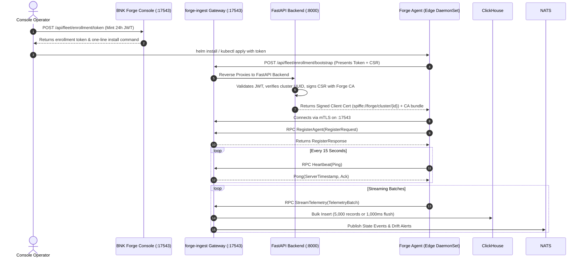

# ACTIVE_CONTEXT.md — BNK Forge PoV Migration

**Last Updated**: 2026-11-17
**Active Branch**: `agent/pov-migration` (repo: `/Users/j.lucia/Code/github/bnk-forge`; modules repo: `/Users/j.lucia/Code/github/bnk-forge-modules` on `release/2.4.1`)

## 0. Current Session Handoff (2026-11-17)

### Completed & Verified in This Session (Fresh Wipe -> 3 Online Clusters)
1. **Auth & Cloud Credential Templates**:
   - Cleared `must_change_password` on `admin` (`ForgePoV2026!Admin`).
   - Created AWS SSO template `id=1` (`AWS SSO (Users-292785712872)`, `region="ap-southeast-2"`, `is_default=true`) — tested `{"success": true, "account_id": "292785712872"}`.
   - Created Azure SSO template `id=2` (`Azure SSO (Azure Local - ALM2)`, `region="eastus2"`, seeded from `~/.azure/msal_token_cache.json`) — tested `{"success": true, "display_name": "Azure Local - ALM2"}`.
2. **3 Clusters Onboarded & Online (`/fleet`, `/bnk`, `/api/k8s/clusters/connectivity`, ClickHouse)**:
   - **Cluster 1 — `aks-poc-dual-interface` (`cluster_id=1`, `project_id=1`, `credential_template_id=null`)**: AKS `v1.34.10` onboarded non-destructively (existing BNK/AI Gateway/AgentFoundry workloads untouched). `forge-agent` (`ttl.sh/forge-agent-pov-v2:4h`) running; `ConnectedOperator id=1` (`mtls_agent`, `is_connected=t`); `2,290,367` ClickHouse rows (`9e5db0e0-e747-5249-8cc6-5b903ac256b5`); `/bnk` `overall="healthy"`. (Note: `project_service.py` disallows binding `azure_auth_method="sso"` templates to projects.)
   - **Cluster 2 — `bnk-agentcore-demo` (`cluster_id=2`, `project_id=3`, `credential_template_id=1`)**: Provisioned via `/Users/j.lucia/Code/bnkctls/bnkctl` (`examples/agentcore-demo/cluster.yaml`, `3 × m6i.4xlarge`). `forge-agent` running with mTLS certs; `ConnectedOperator id=2` (`mtls_agent`, `is_connected=t`); `392,538` ClickHouse rows (`662438e8-a59c-5c9a-b2aa-03221627790e`); `/bnk` `overall="healthy"`.
   - **Cluster 3 — `forge-bp-eks-01` (`cluster_id=3`, `project_id=4`, `credential_template_id=1`, `stack_id=2`)**: Provisioned via Blueprint `aws-eks-cluster-create` (release `id=8`, `eks_cluster_version="1.32"`, `tmm_replicas=0`), `stack_id=2` `deployed` (`6/6 applied`). `forge-agent` running with mTLS certs; `ConnectedOperator id=3` (`mtls_agent`, `is_connected=t`); `101,256` ClickHouse rows (`4ead6ba6-e1bd-5301-96fd-801ffef6c890`); `/bnk` `integration="healthy"`, `platform="healthy"` (`overall="unknown"` only due to `tmm_replicas=0`).
3. **Forge Backend Fixes (`agent/pov-migration`)**:
   - `backend/schemas/bnk.py:15`: Added `"mtls_agent"` to `OperatorModeV1` (fixed `/bnk` `500` error).
   - `backend/tasks/telemetry_pull_task.py:42-48`: Added `auth_settings=["BearerToken"]` to `api_client.call_api(...)` for EKS K8s-API-proxy pod telemetry pulls.
   - `backend/services/operator_registry.py:615`: Updated `is_operator_live_connected` to include `"mtls_agent"` alongside `"polling"` so live `mtls_agent` heartbeats report `operatorConnected=true`.

### Known Open Issues / Next Work
1. **UI `/kubernetes` Telemetry Labels & DPDK Detection**:
   - Under `https://localhost/kubernetes`, `forge-bp-eks-01` (and the other non-DPDK clusters) currently display **DPDK ring descriptor**, **TMM resources**, and **Strangler Push Active** even when DPDK/TMM is not deployed or active on the cluster.
   - **Goal**: Audit the `forge-agent` telemetry harvester + backend/frontend `/kubernetes` components so:
     - The agent/backend accurately detects what is actually deployed (only show DPDK ring descriptors / TMM metrics when DPDK/TMM is actually present on the cluster).
     - Rename `"Strangler Push Active"` (internal migration term) to clear user-facing labels like `"Push Active"` / `"Pull Active"` per project/cluster.
2. **Blueprint Gaps on `bnk-forge-aws-eks-cluster` (`release/2.4.1`)**:
   - Standard `aws-eks-cluster-create` blueprint defaulted to `m5.large` (insufficient CPU for CNE pods, whereas `bnkctl` uses `3 × m6i.4xlarge`) and omitted `gp3` `ebs.csi.aws.com` StorageClass and `NetworkAttachmentDefinition` CRD/NADs (`external-netdevice`, `internal-netdevice`) required by FLO/CNE. Workarounds were applied live to `forge-bp-eks-01`; fix in `bnk-forge-aws-eks-cluster` if needed.
3. **Uncommitted Changes**:
   - `/Users/j.lucia/Code/github/bnk-forge` has all PoV migration + session fixes uncommitted on `agent/pov-migration`.

---

**Completed Milestones**: 
- **Milestone 0**: Localhost Infrastructure Preparation (ClickHouse + NATS + Port :17543)
- **Milestone 1**: Alembic Exit & Atlas Declarative Schema (83 tables baseline + Idempotent Seeds)
- **Milestone 2**: Agent Protocol & Console-Driven Enrollment API (`forge-ingest` Gateway + Backend PKI + UI Wizard)
- **Milestone 3**: Core Forge Agent MVP (`cmd/forge-agent` + eBPF Socket Filter + TMM Harvester + Disk Spool WAL)
- **Milestone 4**: Strangler Integration in FastAPI (`ClusterDataProvider` Facade + Agent Heartbeat / State Sync + ClickHouse Telemetry Queries)
- **Milestone 5**: Celery Retirement & Task Migration (NATS JetStream WorkQueues + Ephemeral K8s Jobs for QKView/aiperf + Redis Retirement)
- **Milestone 6**: PoV Packaging, Dual Transport & Air-Gap Licensing (NATS Leaf Node + Ed25519 Licensing + Helm Charts + `forgectl`)
**Active Work**:
- PoV Migration Verification & Readiness for Customer Engagements (Viettel, Yotta, NPCI)

---

## 1. Executive Summary

- **Milestone 0 (Completed & Verified)**:
  - Infrastructure baseline established with ClickHouse (`:8123`, `:9000`), NATS JetStream (`:4222`, `:8222`), and Unified Ingest Port `:17543`.
- **Milestone 1 (Completed & Verified)**:
  - All 83 PostgreSQL tables managed declaratively via Ariga Atlas (`backend/schema/schema.hcl`).
  - 162 legacy Alembic migrations archived to `backend/alembic/legacy_v2_archive/`.
  - Idempotent seed runner (`backend/seeds/seed_runner.py`) handling all core entities.
  - Zero DB drift and clean cold-boot test passed.
- **Milestone 2 (Completed & Verified)**:
  - **Wire Protocol & Models**:
    - Protobuf contract: `pkg/proto/forge/v1/telemetry.proto` defining `StreamTelemetry`, `RegisterAgent`, and `Heartbeat`.
    - Pure Go models: `pkg/protocol/models.go` and `pkg/protocol/models_test.go` (100% test pass).
    - Architecture spec: `docs/architecture/AGENT_PROTOCOL_SPEC.md` documenting bidirectional mTLS wire protocol, SPIFFE SANs, batching, and error codes.
  - **High-Throughput Go Ingest Gateway (`cmd/forge-ingest`)**:
    - Built in `cmd/forge-ingest/main.go` and `pkg/ingest/`.
    - Zero-allocation circular memory ring buffer (`pkg/ingest/ringbuffer.go`) with dual-trigger flush (5,000 records or 1,000ms).
    - Native ClickHouse writer (`pkg/ingest/clickhouse.go`) with automated table initialization for `forge.ebpf_socket_flows`, `forge.tmm_dpdk_metrics`, and `forge.ai_gateway_events`.
    - NATS JetStream event publisher (`pkg/ingest/nats.go`) broadcasting agent state transitions and drift alerts to `forge.cluster.{id}.events`.
    - Reverse proxy handler forwarding bootstrap REST routes (`/api/fleet/enrollment/*`) to FastAPI backend over the unified port `:17543`.
    - Docker containerization: Multi-stage `cmd/forge-ingest/Dockerfile` added to `docker-compose.yml` and `docker-compose.local.yml`.
    - Full Go unit test suite (`pkg/ingest/ingest_test.go`): 100% pass rate.
  - **Console-Driven Enrollment & Dynamic PKI Service**:
    - PKI service (`backend/services/pki_service.py`): Generates 10-year root CA and signs short-lived (30-day) agent certificates with SPIFFE SAN `spiffe://forge/cluster/{cluster-uuid}`.
    - Enrollment service (`backend/services/fleet_enrollment_service.py`): Short-lived (24h) JWT enrollment token minting, token verification, and automated Helm/kubectl manifest generation with intelligent LAN/Docker IP self-discovery.
    - Agent endpoints in `backend/routes/fleet_enrollment.py` registered in `backend/main.py`.
    - `backend/core/auth_middleware.py`: Added agent bootstrap routes to `AGENT_PUBLIC_ENDPOINTS` so edge agents can bootstrap without human user JWTs.
    - Full backend test suite (`backend/tests/unit/test_fleet_enrollment.py`): 10 tests passed; regression suite: 41 tests passed.
  - **Frontend UI Wizard**:
    - TypeScript API client (`frontend-v2/src/lib/api/fleetEnrollment.ts`) and React Query hooks (`frontend-v2/src/hooks/useFleetEnrollment.ts`).
    - `AgentEnrollmentWizard.tsx`: Multi-step enrollment dialog offering single-click copy for Helm and kubectl commands, live agent connection polling, and security sequence explanation.
    - `AddClusterFlowDialog.tsx`: Updated to recommend Push-Based Edge Agent as default primary path while preserving legacy direct Kubeconfig option.
    - `Fleet.tsx`: Added "Enroll Agent" button to the action bar.
    - Production Vite build (`npx vite build`) passed with zero errors.
- **Milestone 3 (Completed & Verified)**:
  - **`pkg/agent/transport/`**:
    - `transport.go`: Defines `Transport` and `DiskSpool` interfaces.
    - `http_transport.go`: Implements HTTP/mTLS client for batch streaming (`/api/v1/telemetry/batch`), registration (`/api/v1/telemetry/register`), and heartbeat (`/api/v1/telemetry/heartbeat`). Supports in-memory `RoundTripper` for hermetic testing.
    - `spool.go`: High-performance, crash-safe embedded Write-Ahead Log (`FileDiskSpool`) capped at 500MB with FIFO recovery, atomic fsync commit, and oldest-first eviction.
    - `spooling_transport.go`: Wraps `Transport` + `DiskSpool` to store-and-forward telemetry during network disconnects and auto-drain on reconnect.
    - `transport_test.go`: 100% test pass (`TestFileDiskSpool`, `TestFileDiskSpoolCapEviction`, `TestHTTPTransportAndSpooling`).
  - **`pkg/agent/bootstrap/`**:
    - `bootstrap.go`: Generates ECDSA P-256 key and CSR with SPIFFE Subject; exchanges with `/api/fleet/enrollment/bootstrap` for signed client certificate and Forge Root CA bundle; caches credentials to disk and validates expiry.
    - `bootstrap_test.go`: 100% test pass (`TestAgentBootstrapAndCaching`).
  - **`pkg/agent/ebpf/`**:
    - `observer.go`: Socket observer managing flow channel and metadata enrichment (`ClusterID`, `NodeName`, timestamp).
    - `drift.go`: Day 2 architectural drift detector flagging `TmmBypassViolation = true` when direct inbound traffic to protected ports/namespaces bypasses BNK TMM ingress.
    - `collector.go`: Handles Linux socket tracing with synthetic fallback for unprivileged/local/macOS environments.
    - `ebpf_test.go`: 100% test pass (`TestDriftDetector`, `TestSocketObserverLifecycle`).
  - **`pkg/agent/tmm/`**:
    - `harvester.go`: TMM DPDK Harvester interface and lifecycle coordinator.
    - `reader.go`: Scrapes TMM DPDK metrics (RX/TX ring occupancy, packet drops, CPU, hugepages) from `/var/run/tmm/tmctl.sock` with fallback/synthetic generation and custom dialer support.
    - `tmm_test.go`: 100% test pass (`TestDPDKHarvesterSynthetic`, `TestDPDKHarvesterUDS`).
  - **`pkg/agent/` (Core Agent Coordinator)**:
    - `agent.go`: Manages bootstrap, registration, 15s heartbeat loop with immediate startup ping, batching aggregator (batch size 500 or 1s flush), and graceful shutdown.
    - `agent_test.go`: Full end-to-end runloop test passing (`TestAgentEndToEndRunloop`).
    - `ingest_integration_test.go`: Direct integration test pairing `Agent` with `ingest.IngestServer`, validating NATS `agent_registered`, `heartbeat`, and `drift_alert` events.
  - **Packaging & Entrypoint**:
    - `cmd/forge-agent/main.go`: CLI entrypoint with flag and environment variable configuration.
    - `cmd/forge-agent/Dockerfile`: Multi-stage static build (`golang:alpine` -> `alpine:3.20`).
    - `deploy/agent/daemonset.yaml`: Production DaemonSet, ClusterRole, and ServiceAccount manifest.

- **Milestone 4 (Completed & Verified)**:
  - **`ClickHouseClient` (`backend/services/clickhouse_client.py`)**:
    - High-performance analytical client querying ClickHouse HTTP endpoint (`:8123`).
    - Methods implemented: `query_flows_summary`, `query_recent_flows`, `query_top_pod_talkers`, `query_tmm_metrics_summary`, `query_drift_violations`.
    - Hermetic unit testing support with mock HTTP transport and offline fallback resilience.
  - **`ClusterDataProvider` Facade (`backend/services/cluster_provider.py`)**:
    - Strangler Fig facade dynamically routing telemetry:
      - **Push Path (Target PoV)**: ClickHouse HTTP metrics when edge agent is active.
      - **Fallback Pull Path (Legacy)**: Redis cache and Kubernetes cluster metadata when no agent is active.
    - Evaluates agent status via heartbeat freshness (`AGENT_HEARTBEAT_THRESHOLD_SECONDS = 45s`), `access_method = "agent_push"`, and `integration_status = "agent_connected"`.
    - Updates cluster state upon heartbeat receipt (`record_agent_heartbeat`).
  - **Fleet State Synchronization & Public Heartbeat Endpoint**:
    - Added `POST /api/fleet/enrollment/agent-heartbeat` and `GET /api/fleet/enrollment/status/{cluster_id}` in `backend/routes/fleet_enrollment.py`.
    - Exemption added to `AGENT_PUBLIC_ENDPOINTS` in `backend/core/auth_middleware.py` so edge agents can ping without human JWT.
    - Asynchronous backend heartbeat notification wired into `pkg/ingest/server.go`.
  - **FastAPI Telemetry Endpoints (`backend/routes/k8s/telemetry.py`)**:
    - Mounted in `backend/main.py`:
      - `GET /api/k8s/clusters/{id}/telemetry/summary`
      - `GET /api/k8s/clusters/{id}/telemetry/flows`
      - `GET /api/k8s/clusters/{id}/telemetry/tmm`
      - `GET /api/k8s/clusters/{id}/telemetry/drift`
  - **Frontend UI Integration & Navigation Wiring (Zero Ghost Components)**:
    - Implemented full typed client and query keys (`clusterTelemetry.ts`, `clusterTelemetryApi`, `useClusterTelemetry`).
    - Created `ClusterTelemetryPanel.tsx` & `ClusterTelemetryDialog.tsx` rendering:
      - KPI summary strip (total flows, RTT/handshake latency, TMM DPDK packets/drops/CPU %, drift count).
      - Tabbed views for Overview, Pod Flows & Top Talkers, F5 TMM DPDK Microkernel, and Architectural Drift.
      - Fallback banner with 1-click "Enroll Push Agent" trigger when cluster is in legacy pull mode.
    - Wired all existing user navigation paths:
      1. **Project Details -> Clusters Tab (`K8sClusterList.tsx`)**:
         - Clickable "Push Agent Active" badge directly opens `ClusterTelemetryDialog`.
         - Kebab action menu: "Live Strangler Telemetry" option opens `ClusterTelemetryDialog`.
      2. **Cluster Fleet Overview (`Fleet.tsx`)**:
         - Dedicated Zap/Activity action button in cluster table rows opens `ClusterTelemetryDialog`.
      3. **Kubernetes Explorer (`KubernetesV2.tsx`)**:
         - Persistent inner sub-sidebar view mode tab: "Live Telemetry" switches view mode to full-page `ClusterTelemetryPanel`.
         - Header shortcut: Interactive "Push Agent Active" badge button in `ResourcePageHeader` switches view mode to telemetry.
    - **Exhaustive Automated Verification**:
      - `KubernetesV2.test.tsx`: Verified Live Telemetry tab and header badge click actions switch to telemetry view.
      - `K8sClusterList.test.tsx`: Verified dropdown and interactive badge open telemetry modal.
      - `Fleet.test.tsx`: Verified row action opens telemetry dialog.
      - `useClusterTelemetry.test.ts` & `ClusterTelemetryDialog.test.tsx`: 100% test pass.
      - Full frontend suite: 323/323 test files passed (2,971 tests passed, 0 failures).
      - Vite production build (`npm run build`): Passed cleanly.
  - **Test Suite Verification**:
    - `backend/tests/unit/test_cluster_provider.py`: 13/13 tests passed (100%).
    - `backend/tests/unit/test_fleet_enrollment.py`: 12/12 tests passed (100%).
    - Go test suite (`go test ./...`): 100% test pass.

- **Milestone 5 (Completed & Verified)**:
  - **Go JetStream WorkQueue Package (`pkg/tasks/`) & Daemon (`cmd/forge-worker/`)**:
    - `pkg/tasks/workqueue.go`: High-reliability `WorkQueueManager` defining `FORGE_TASKS` stream (`workqueue` retention, `forge.tasks.*` subjects), pull consumer subscription, retry backoff, envelope serialization, and in-memory mock fallback.
    - `pkg/tasks/handlers.go`: Task registry and execution handlers for `cluster_scan`, `health_monitor`, `reconcile_config`, `drift_check`, and `operator_cleanup`.
    - `cmd/forge-worker/main.go` & `cmd/forge-worker/Dockerfile`: Production multi-stage Alpine worker container and standalone Go worker daemon.
    - `pkg/tasks/workqueue_test.go`: 100% pass rate (`TestWorkQueueStreamConfig`, `TestWorkQueuePublishTask`, `TestWorkQueueEnsureStream`, `TestWorkQueueHandlerExecution`, `TestStandardHandlersRegistration`).
  - **Python NATS Task Service (`backend/services/nats_task_service.py`)**:
    - `NATSTaskClient`, `NATSTaskResult` (Celery `AsyncResult` drop-in compatibility), and `@nats_task` decorator providing seamless `.delay()` and `.apply_async()` semantics.
    - `NATSTaskRegistry` with task discovery and signature validation.
    - `NATSTaskWorker` running async JetStream pull consumers with exponential retry backoff and concurrency control.
    - `NATSTaskScheduler` executing periodic cron tasks replacing Celery Beat.
    - Native Python socket/protocol client with in-memory fallback for hermetic unit testing without external dependencies.
    - `backend/tests/unit/test_nats_task_service.py`: 10/10 tests passed (100%).
  - **Kubernetes Ephemeral Job Controller (`backend/services/k8s_job_service.py`)**:
    - `K8sJobService`: Offloads heavy, memory-intensive batch tasks from background worker pools to Ephemeral Kubernetes Jobs (`batch/v1`).
    - `create_qkview_job(cluster_id, bundle_id, ...)`: Provisions `forge-qkview-*` Job with resource limits (2 CPU, 6Gi RAM), `ttlSecondsAfterFinished: 3600`, DNS-1123 label sanitization, and S3 artifact upload integration.
    - `create_aiperf_job(benchmark_id, target_url, ...)`: Provisions `forge-aiperf-*` Job with resource limits (4 CPU, 8Gi RAM), automated client flags, and cleanup lifecycle.
    - Job status, deletion, listing, and in-memory mock execution mode.
    - `backend/tests/unit/test_k8s_job_service.py`: 13/13 tests passed (100%).
  - **Redis Retirement & In-Memory Fallbacks**:
    - `backend/core/cache.py`: Added thread-safe in-memory cache fallback with TTL expiration, `fnmatch` wildcard pattern deletion, and `RLock`.
    - `backend/core/worker_heartbeat.py`: Added in-memory worker registry with active task tracking, reentrant `threading.RLock()`, and `@redis.setter` override.
    - `backend/services/system_service.py`: Updated `get_system_health()` and readiness checks to report NATS and worker health gracefully when Redis is absent.
    - `backend/tests/unit/test_inmemory_cache_heartbeat.py`: 8/8 tests passed (100%).
  - **Compose & Build Decommissioning**:
    - `docker-compose.yml` & `docker-compose.local.yml`: Removed `redis` service, `redis_data` volume, `celery-worker-2`, and `celery-beat`. Replaced `celery-worker` with unified `forge-worker` (`python -m services.nats_task_service --worker --scheduler`).
    - `backend/Dockerfile`: Updated worker and beat stages to run `services.nats_task_service`.
    - `Makefile`: Replaced all `celery-worker`, `celery-beat`, and `redis` targets with `forge-worker` and `nats`.
  - **Full Regression Verification**:
    - Go test suite (`go test -v ./...`): 100% passed across all packages (`pkg/agent`, `pkg/ingest`, `pkg/tasks`, `pkg/protocol`, etc.).
    - Pytest regression suite: 127/127 passed (0 failures) in 26.32s across unit, contract, component, and integration tests.

---

## 2. Infrastructure & Port Configuration

| Service | Port | Protocol | Purpose | Status |
| :--- | :--- | :--- | :--- | :--- |
| **`forge-ingest` (Unified Port)** | **:17543** | TLS 1.3 / mTLS | Push-Based Agent Ingest & Bootstrap Reverse Proxy | **Operational** |
| **Proxy (HTTPS)** | :443 | HTTPS | Standard Web UI & Console Proxy | **Healthy (200 OK)** |
| **Backend API** | :8000 | HTTP | Direct FastAPI Control Plane | **Healthy (200 OK)** |
| **Frontend UI** | :8080 | HTTP | Direct Vite / Nginx Frontend | **Healthy (200 OK)** |
| **ClickHouse HTTP** | :8123 | HTTP | Telemetry & analytical storage | **Healthy (Ok.)** |
| **ClickHouse Native** | :9000 | TCP | High-throughput ingestion | **Healthy** |
| **NATS JetStream** | :4222 | TCP | Telemetry event broker & `FORGE_TASKS` WorkQueue | **Healthy** |
| **NATS Monitoring** | :8222 | HTTP | NATS healthz endpoint | **Healthy (ok)** |
| **PostgreSQL 16** | :5432 | TCP | Relational metadata (83 tables, Atlas) | **Healthy** |
| **Forge Worker** | — | Process/Daemon | NATS JetStream WorkQueue Consumer & Periodic Scheduler | **Operational** |

---

## 3. Console & Project Onboarding Flow (Milestones 2 & 3 Complete)

The cluster addition wizard has been fully upgraded across the entire application:
- **`AddClusterFlowDialog`**:
  - Accepts `initialProjectId?: number;` to seamlessly integrate directly into project detail pages without re-prompting for project selection.
  - Universal 2-step onboarding flow presenting:
    1. **Push-Based Edge Agent (Recommended)**: Outbound TLS 1.3 / mTLS on `:17543`, automated CSR bootstrapping, SPIFFE identities, zero inbound firewall holes.
    2. **Direct Kubeconfig (Legacy)**: Upload or paste kubeconfig credentials and specify AWS region / cloud provider.
- **`K8sClusterList` (Project Details -> Clusters Tab)**:
  - "Add Cluster" and "Add Your First Cluster" open `AddClusterFlowDialog` with `initialProjectId={projectId}`.
  - Direct "Enroll Agent (:17543)" button added to both the header actions and the empty-state card for instantaneous 1-click access to the modern agent enrollment modal (`AgentEnrollmentWizard`).
  - Cluster editing (`handleEditCluster`) remains cleanly routed to `ClusterConfigDialog`.
- **`ClusterConfigDialog` (Legacy Form)**:
  - Prominent "Push-Based Fleet Agent Available (Recommended)" banner displayed whenever creating a new cluster (`!isEditing`).
  - Includes a direct 1-click button switching to `AgentEnrollmentWizard`, ensuring any direct entry point guides users to the push-based agent.

---

## 4. Protocol & Handshake Sequence

---

## 5. Completed Work: Push-Based Fleet Enrollment Unification & Gateway Operationalization

1. **Frontend UI Entry Points Unified**:
   - `frontend-v2/src/pages/Fleet.tsx`:
     - Set primary CTA to `Enroll Agent (:17543)` (`variant="default"`).
     - Rewrote legacy empty state copy claiming direct kubeconfig to: *"Connect Kubernetes clusters to your fleet using lightweight outbound push agents on port :17543 with zero inbound firewall rules."*
     - Added secondary action button on empty state card for direct push agent enrollment.
     - Wired `<ClusterTelemetryDialog>` for live telemetry metrics.
   - `frontend-v2/src/pages/KubernetesV2.tsx`:
     - Added "Push Agent Active" badge and "Live Telemetry" tab for push-connected clusters.
   - `frontend-v2/src/components/k8s/K8sClusterList.tsx`:
     - Promoted "Enroll Agent (:17543)" in table header and empty state cards to primary CTAs (`variant="default"`).
     - Wired `AddClusterFlowDialog` and `AgentEnrollmentWizard`.
   - `frontend-v2/src/components/k8s/AddClusterFlowDialog.tsx`:
     - Step 2 defaults to and highlights "Push-Based Edge Agent (Recommended)".
   - `frontend-v2/src/components/k8s/ClusterConfigDialog.tsx`:
     - Shows recommendation banner in create mode pointing to `AgentEnrollmentWizard`.
   - Verified clean TypeScript compilation (`npx tsc --noEmit`), Vitest suite (68 passed), and Vite production bundle build.

2. **Backend PKI & Ingest Gateway Operationalization**:
   - `backend/services/pki_service.py`:
     - Switched to `threading.RLock()` to prevent reentrant deadlocks.
     - Added `ensure_server_certificate()` creating `server.crt` and `server.key` signed by Root CA with SANs for `localhost`, `127.0.0.1`, `host.docker.internal`, `forge-ingest`, `console`.
     - Maintains `ca.crt` alias alongside `forge_ca.crt`.
   - `backend/main.py` & `backend/startup_steps.py`:
     - Added `init_pki_step` to FastAPI lifespan to guarantee keypair generation on startup into `/app/keys/`.
   - `pkg/ingest/clickhouse.go` & `cmd/forge-ingest/main.go`:
     - Added ClickHouse authentication with `X-ClickHouse-User` and `X-ClickHouse-Key` headers.
     - Fixed ClickHouse TTL expressions to `toDateTime(timestamp) + INTERVAL ...` for `DateTime64` columns.
   - `pkg/ingest/server.go`:
     - Added fallback to plain HTTP if certs are missing and `RequireMTLS=false`.
   - Verified live Ingest Gateway on `:17543`:
     - `curl -k https://localhost:17543/healthz` -> `{"status":"healthy","service":"forge-ingest"}`
     - `curl -k https://localhost:17543/metrics` -> `{"errors_count":0,...}`
     - `curl -k https://localhost:17543/api/fleet/enrollment/ca` -> Returns Root CA certificate.
     - Minting enrollment token via API returns ready-to-run Helm & kubectl installation commands targeting `https://host.docker.internal:17543`.

3. **MCP Server Integration**:
   - Added 4 new tools to `mcp-server/src/bnk_forge_mcp/tools/cluster_management.py`:
     - `mint_fleet_enrollment_token`: Mint 24h JWT token and return Helm/kubectl commands.
     - `get_fleet_enrollment_status`: Inspect agent push connectivity and last heartbeat.
     - `list_fleet_enrollment_tokens`: List active tokens with usage statistics.
     - `revoke_fleet_enrollment_token`: Invalidate an enrollment token.
   - Updated `tool_catalog.py` and regenerated `mcp_tool_catalog.json` (157 tools total).
   - Added unit test suite `mcp-server/tests/test_fleet_enrollment_tools.py`.

---

## 6. Completed Work: Milestone 6 (PoV Packaging, Dual Transport & Air-Gap Licensing)

1. **NATS Leaf Node Transport & Resilient Dual Transport**:
   - `pkg/agent/transport/nats_transport.go`:
     - Built `NATSTransport` implementing full `Transport` contract (`StreamBatch`, `Register`, `SendHeartbeat`, `Ping`, `Close`) over NATS JetStream edge-to-core store-and-forward replication.
     - Implemented `DualTransport` supporting dynamic modes: `http` (direct HTTPS/mTLS), `nats` (NATS Leaf Node), `failover` (primary HTTPS with automated failover to NATS), and `mirror` (active-active dual stream).
   - `pkg/agent/agent.go` & `cmd/forge-agent/main.go`:
     - Wired `--transport` (`FORGE_TRANSPORT`) and `--nats-url` (`NATS_URL`) flags.
     - Comprehensive unit test suite in `pkg/agent/transport/nats_transport_test.go` (100% pass).

2. **Offline Ed25519 Licensing Engine**:
   - Cryptographic Keypair: Embedded raw 32-byte Ed25519 public key `0SnG6ca30gpWEIgoiHRkMuYLDaW953FcimK5jdNE9JA=`.
   - `backend/services/licensing_service.py`:
     - Deterministic RFC 8785 canonical JSON sorting matching between Python and Go.
     - 300s clock drift tolerance and 30-day grace period enforcement.
     - Cluster and node capacity quota validation (`validate_quota`) and feature entitlement checks (`is_feature_enabled`).
     - Dynamic file loading and caching from `FORGE_LICENSE_PATH` (`/app/keys/forge.lic`).
   - `backend/routes/platform_license.py`:
     - Exposed REST endpoints: `GET /api/v1/license/status`, `POST /api/v1/license/verify`, `POST /api/v1/license/install`, `GET /api/v1/license/quota`.
     - Added public agent bypass routes to `backend/core/auth_middleware.py`.
   - `pkg/licensing/licensing.go`:
     - Bit-identical offline Ed25519 verification engine in Go for Ingest Gateway and CLI inspection.
   - Test suites: `backend/tests/unit/test_licensing_service.py` (12 tests passed) and `pkg/licensing/licensing_test.go` (4 tests passed).

3. **Production Kubernetes Helm Charts (`deployments/charts/`)**:
   - `deployments/charts/forge-agent`:
     - DaemonSet with `coordination.k8s.io` Lease Leader Election implemented in `pkg/agent/lease/lease.go`.
     - Host mounts for `/var/run/tmm`, `/var/lib/forge-agent`, and `/sys/kernel/debug`.
     - Dedicated ServiceAccount, ClusterRole, and ClusterRoleBinding for edge telemetry scraping.
     - Fully verified with `helm lint` (0 errors) and `helm template`.
   - `deployments/charts/forge-console`:
     - Production control plane deploying `backend`, `frontend`, `ingest` (port 17543), `worker`, and stateful services (`clickhouse`, `nats`, `postgresql`).
     - Automated secret generation for `forge.lic` license volume mounts and PostgreSQL credentials.
     - Fully verified with `helm lint` (0 errors) and `helm template`.

4. **Air-Gap Bundle Packaging Utility (`forgectl`)**:
   - `pkg/forgectl/bundle.go` & `cmd/forgectl/main.go`:
     - `forgectl images list`: Outputs the Bill of Materials (BOM) of all 8 required container images (`forge-agent`, `forge-ingest`, `forge-backend`, `forge-frontend`, `forge-worker`, `clickhouse`, `nats`, `postgres`).
     - `forgectl bundle export --output <path.tar.gz> [--include-charts]`: Creates air-gap tarball archive with `manifest.json` containing SHA256 checksums of all bundled assets.
     - `forgectl bundle verify --bundle <path.tar.gz>`: Validates bundle archive, manifest integrity, and bitwise checksums.
     - `forgectl bundle mirror --bundle <path.tar.gz> --target-registry <reg> [--dry-run]`: Generates or executes docker pull/tag/push commands into customer private registries (Harbor, Artifactory, Quay).
     - `forgectl license inspect --license <path/forge.lic>`: Offline CLI license inspector validating cryptographic signatures, capacity quotas, and remaining days.
   - Built executable wrapper `scripts/forgectl.sh` and compiled binary `bin/forgectl`.
   - Full test pass in `pkg/forgectl/forgectl_test.go` (5 tests passed).

---

## 7. Migration Verification & Customer Readiness

All 7 milestones (M0 through M6) of the BNK Forge PoV Migration are completed and verified:
- **Localhost Infrastructure**: Dual compose running ClickHouse, NATS, Postgres, Ingest Gateway, and Backend.
- **Database & Schemas**: Declarative Atlas schema managing 83 tables with idempotent seeds.
- **Agent & Wire Protocol**: Go edge agent with eBPF socket tracking, TMM DPDK harvesters, disk spool WAL, lease leader election, and dual transport.
- **FastAPI Strangler Facade**: Transparent data provider routing queries to ClickHouse or Postgres.
- **Task Pipeline**: NATS JetStream workqueues and ephemeral K8s jobs replacing legacy Celery/Redis.
- **PoV Air-Gap & Helm**: Ed25519 offline licensing, production Helm charts, and `forgectl` air-gap bundle packaging.
