# F5 BIG-IP Next for Kubernetes — BNK Forge

**The Unified Multi-Cloud & F5 BNK AI Service Plane Control Center for F5 BIG-IP Next for Kubernetes (BNK).**

[](https://github.com/JLCode-tech/bnk-forge/releases)
[](https://clouddocs.f5.com/bigip-next-for-kubernetes/latest/overview.html)
[](#what-you-can-build--operate-with-bnk-forge)
[](https://github.com/JLCode-tech/bnkctl)
[](#6-ai-assisted-day-2-operations-via-153-mcp-server-tools--system-lifecycle)
[](#quick-start)
[](LICENSE)

**BNK Forge 4.0.0** is an enterprise orchestration, observability, and **F5 BNK AI Service Plane** control center purpose-built for [**F5 BIG-IP Next for Kubernetes (BNK)**](https://clouddocs.f5.com/bigip-next-for-kubernetes/latest/overview.html). It provides a single visual and API-driven control plane for multi-cloud CNF lifecycle management, L4/L7 traffic and security policy authoring, real-time AI token governance and guardrails, Smart LLM Routing across **AWS Bedrock**, **Azure AI Foundry**, and **Google Vertex AI**, automated GenAI/dataplane benchmarking, and AI-assisted Day-2 operations via **153 MCP Server Tools** — with native integration into the unified [**`bnkctl`**](https://github.com/JLCode-tech/bnkctl) multi-cloud CLI engine.


---

## Why BNK Forge?

Deploying and operating a high-performance Cloud-Native Network Function (CNF) and **F5 BNK AI Service Plane** across **Amazon EKS**, **Azure AKS**, **Google Cloud GKE**, **Red Hat OpenShift**, and **NVIDIA BlueField-3 DPU** bare-metal clusters traditionally requires stitching together cloud-specific infrastructure templates, secondary NIC plumbing, BGP peering, Kubernetes manifests, and disparate observability stacks.

**BNK Forge** unifies Day-0 architecture, Day-1 provisioning, and Day-2 operations into a single platform:

- **Unified Multi-Cloud Control Plane**: Manage clusters provisioned via Turnkey Blueprints (`81` modules, `13` stack templates), standard kubeconfigs, or automatic zero-touch registration from [**`bnkctl`**](https://github.com/JLCode-tech/bnkctl) (`bnkctl up`).
- **Visual Traffic & Security Policy Authoring**: Configure L4/L7 traffic routing, carrier-grade network translation, DNS delivery, and zero-trust security policies visually without hand-crafting raw YAML manifests. See the [F5 BIG-IP Next for Kubernetes CloudDocs](https://clouddocs.f5.com/bigip-next-for-kubernetes/latest/overview.html) for full platform capabilities.
- **Turnkey F5 BNK AI Service Plane**: Real-time multi-cloud AI token accounting, tenant budget and rate enforcement, sensitive data (PII/DLP) guardrails, prompt-injection defense, and weighted Smart LLM Routing across **AWS Bedrock**, **Azure AI Foundry**, and **Google Vertex AI**.
- **Built-In GenAI & Dataplane Benchmarking**: Compare Time-to-First-Token (TTFT), Inter-Token Latency (ITL), token velocity (`tok/s`), and L4/L7 throughput across **F5 BNK + F5 GAIE**, Envoy, HAProxy, and `llm-d` Router (`139` pre-validated benchmark runs across `21` run groups).
- **153 Governed MCP Server Tools & 200+ REST Endpoints**: Connect Claude, Antigravity, or custom automation pipelines directly to your multi-cloud fleet under strict role-based risk tiers (Read-Only, Mutate, Destructive) and immutable audit logging.

---

## What You Can Build & Operate with BNK Forge

### 1. Unified Multi-Cloud Cluster Fleet & Blueprints Catalog

Manage **AWS EKS**, **Azure AKS**, **GCP GKE**, **OpenShift**, and **Bare-Metal / BlueField-3 DPU** clusters from a single **Cluster Fleet** view with live data-plane telemetry, active listeners, BGP status, configuration drift detection, and one-click deployable **Multi-Cloud Blueprints**:


### 2. Visual Network Security & Traffic Policy Management

Author, visualize, and enforce L4/L7 traffic routing, carrier-grade network translation, DNS delivery, and zero-trust security policies across your Kubernetes clusters from a single visual interface or declaratively via [**`bnkctl`**](https://github.com/JLCode-tech/bnkctl). For complete details on F5 BIG-IP Next for Kubernetes traffic and security capabilities, see the [F5 BIG-IP Next for Kubernetes CloudDocs](https://clouddocs.f5.com/bigip-next-for-kubernetes/latest/overview.html).


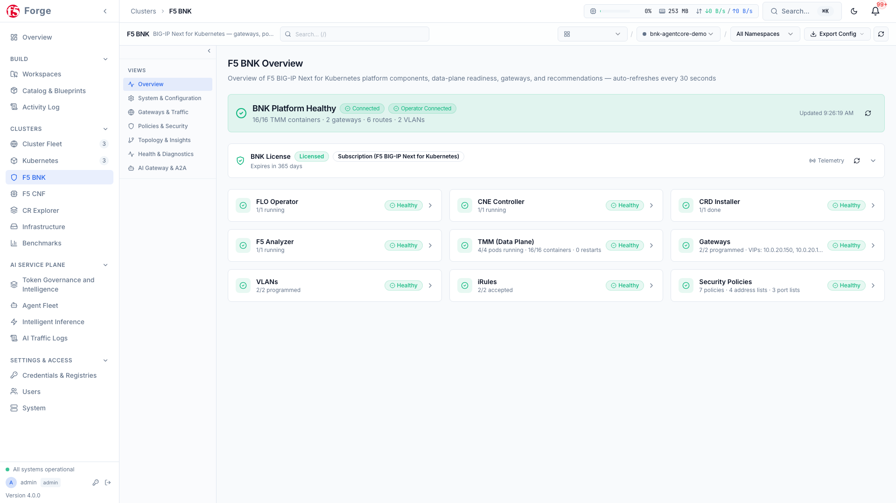

### 3. F5 BNK AI Service Plane: Token Governance & Data Guardrails

Deliver enterprise-grade AI traffic governance across every cloud with real-time token accounting, budget and rate enforcement, sensitive data (PII/DLP) guardrails, and prompt-injection protection managed through **BNK Forge**. Learn more about F5's cloud-native data plane and AI traffic capabilities in the [F5 BIG-IP Next for Kubernetes CloudDocs](https://clouddocs.f5.com/bigip-next-for-kubernetes/latest/overview.html).


<details>
<summary><b>View Per-Cloud AI Token Governance (AWS Bedrock, Azure AI Foundry & Google Vertex AI)</b></summary>

#### AWS EKS (`agentcore-demo` — Amazon Bedrock Claude Sonnet / Haiku)


#### Azure AKS (`agentfoundry-demo` — Azure AI Foundry GPT-4o / GPT-4.1)
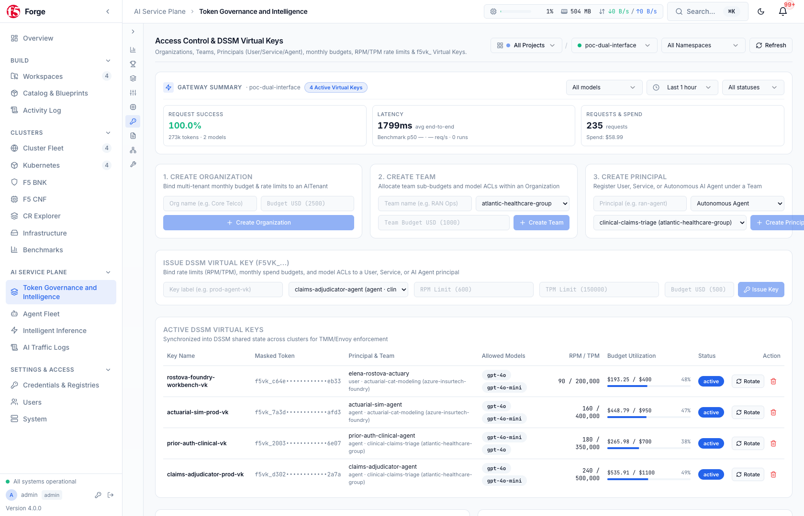

#### GCP GKE (`vertex-agent-demo` — Google Vertex AI Gemini 2.5 Pro / Flash)
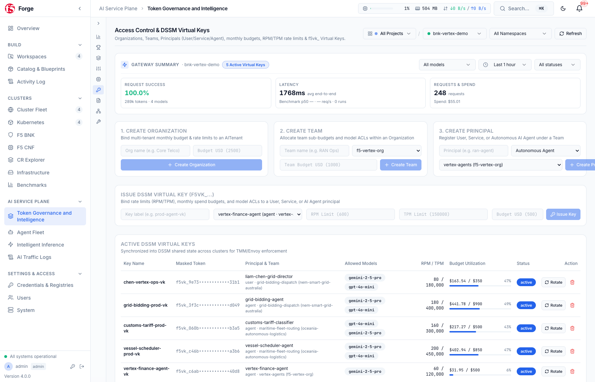

</details>

### 4. Smart LLM Router Fleet across AWS Bedrock, Azure AI Foundry & Google Vertex AI

Route agentic and inference traffic across primary and fallback foundation models in **AWS Bedrock** (Claude Sonnet / Haiku), **Azure AI Foundry** (GPT-4o / GPT-4.1), and **Google Vertex AI** (Gemini 2.5 Pro / Flash) — complete with Model Context Protocol (MCP) tool security, real-time KV-cache & queue-depth scoring, and weighted regional failover:


<details>
<summary><b>View Cloud-Specific LLM Router Pools (AWS, Azure & GCP)</b></summary>

#### AWS Bedrock Pools (`ap-southeast-2` &rarr; `us-east-1` fallback)


#### Azure AI Foundry Pools (`eastus2` &rarr; `swedencentral` fallback)


#### GCP Vertex AI Pools (`australia-southeast1` &rarr; `us-central1` fallback)


</details>

### 5. Automated GenAI & Dataplane Benchmarking (`aiperf` + Multi-Stack Pareto Frontiers)

Compare throughput, Time-to-First-Token (TTFT), Inter-Token Latency (ITL), and token-rate enforcement across **F5 BNK + F5 GAIE**, Envoy, HAProxy, and `llm-d` Router across concurrency tiers:


### 6. AI-Assisted Day-2 Operations via 153 MCP Server Tools & System Lifecycle

Inspect, diagnose, and operate every registered cluster through BNK Forge's built-in **Model Context Protocol (MCP) Server** (`153` structured tools across Read-Only, Mutate, and Destructive safety tiers), alongside real-time container lifecycle monitoring, automated PostgreSQL backups, and one-command platform upgrades:


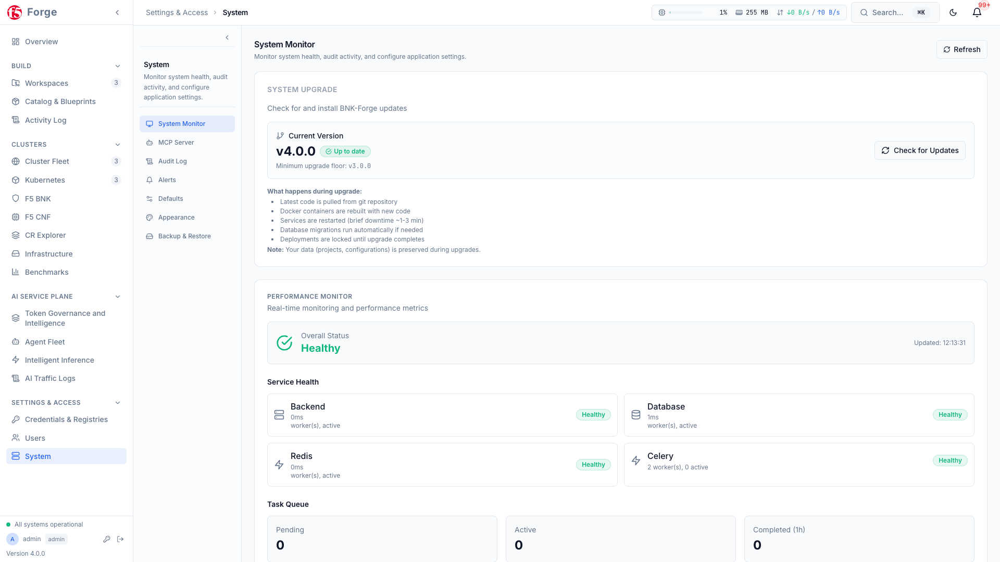

<details>
<summary><b>View Additional Console Views (Light Theme, CR Explorer, Credentials & Container Guardrails)</b></summary>

#### Command Center (Light Theme)
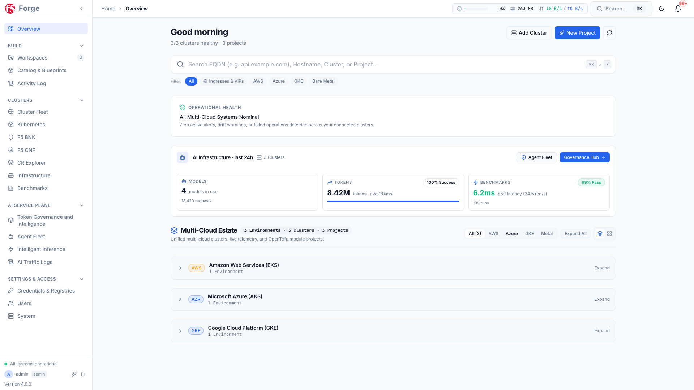

#### Kubernetes & F5 BNK CNF Explorer
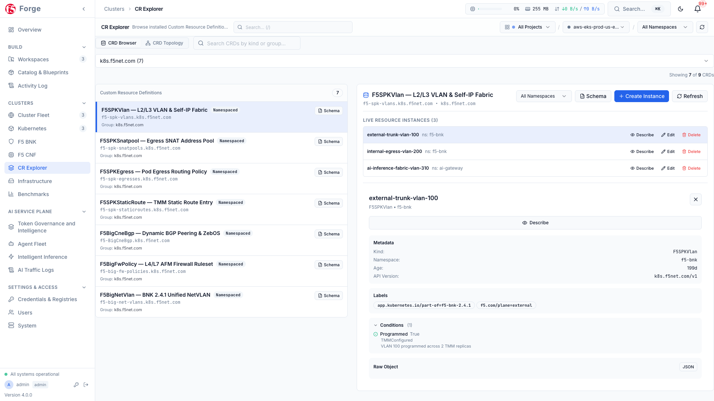

#### Cloud Credentials & Container Registries
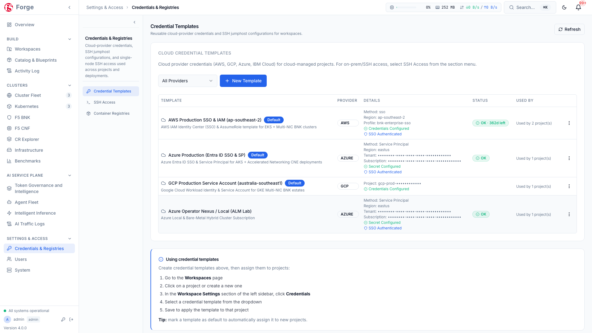

#### Container Lifecycle & Guardrails
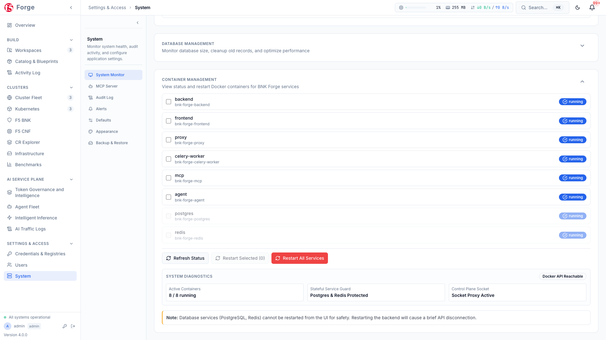

</details>

---

## Companion CLI Ecosystem: [`bnkctl`](https://github.com/JLCode-tech/bnkctl)

**BNK Forge** integrates natively with [**`bnkctl`**](https://github.com/JLCode-tech/bnkctl) — the pure-Go, multi-cloud lifecycle and validation CLI for **F5 BIG-IP Next for Kubernetes (BNK)** and the **F5 BNK AI Service Plane**.

When `forge.enabled: true` is configured in a `bnkctl` `cluster.yaml`, running `bnkctl up` automatically provisions the cloud underlay and BNK overlay, registers the cluster into **BNK Forge**, seeds multi-cloud AI Token Governance and Smart LLM Routing, and cleanly unregisters on `bnkctl down`:

| Repository / Binary | Target Cloud | Capabilities & Integration |
| :--- | :--- | :--- |
| [**`bnkctl`**](https://github.com/JLCode-tech/bnkctl) | **AWS, Azure, GCP** | Unified multi-cloud Go engine (`--cloud aws\|azure\|gcp` or auto-detected from `cluster.yaml`) with native `bnkctl forge {register,unregister,status,governance}` and `bnkctl genai parse` integration. |
| [**`awsbnkctl`**](https://github.com/JLCode-tech/awsbnkctl) | **AWS EKS** | VPC + Public/Private/DataPath Subnets (including AWS Local Zones), secondary ENIs, AWS Route Server BGP peering, and AWS Bedrock **F5 BNK AI Service Plane** integration. |
| [**`azrbnkctl`**](https://github.com/JLCode-tech/azrbnkctl) | **Azure AKS** | VNet + System & TMM Node Pools, Accelerated Networking (`dual-interface`), dynamic secondary NIC attachment, and Azure AI Foundry **F5 BNK AI Service Plane** integration. |
| [**`gkebnkctl`**](https://github.com/JLCode-tech/gkebnkctl) | **GCP GKE** | Multi-VPC (`main`, `external`, `internal`) with Jumbo Frames (MTU 8896), GKE multi-network pod attachments, and Google Vertex AI **F5 BNK AI Service Plane** integration. |

---

## Operational Comparison: Manual CLI vs BNK Forge

| Operational Area | Manual CLI & Manifests | BNK Forge Management Plane |
|---|---|---|
| **Cluster Provisioning** | Manual infrastructure scripts, Helm values, and custom YAML pipelines | Turnkey multi-cloud blueprints + automatic registration via [`bnkctl`](https://github.com/JLCode-tech/bnkctl) |
| **Topology & Traffic Flow** | Inspecting disparate Gateway, Route, and Policy manifests across namespaces via CLI | Interactive visual graph mapping Gateways, Listeners, Policies, Routes, and Backends |
| **Diagnostics & Troubleshooting** | Manual `kubectl exec` into pods, container log chasing, and manual tarball extraction | Direct CWC QKView export, live `tmctl`/`bdt_cli`/`configview` inspection, automated runbooks |
| **Cross-Cluster Promotion** | Manual YAML file export, text-based diffing, and manual `kubectl apply` | Snapshot engine with semantic cluster-to-cluster diffing and one-click promotion |
| **F5 BNK AI Service Plane** | Disconnected per-cloud token logs and manual model endpoint failover | Unified multi-cloud Token Governance, PII/DLP guardrails, and Smart LLM Routing across AWS, Azure, and GCP |
| **GenAI & Dataplane Benchmarking** | Ad-hoc curl scripts without standardized metrics or concurrency analysis | Integrated benchmark suite tracking TTFT, ITL, token throughput, and latency percentiles across stacks |
| **Automated Tooling** | Uncontrolled shell scripts or ad-hoc API calls without unified audit logging | 200+ RBAC-controlled REST endpoints and 153 governed MCP tools with risk classifications |

---

## Platform Architecture

### High-Level System & Fleet Architecture

BNK Forge 4.0.0 runs as a lightweight, modular Docker Compose stack that connects directly to target Kubernetes clusters via standard kubeconfig credentials or [`bnkctl`](https://github.com/JLCode-tech/bnkctl) lifecycle links:

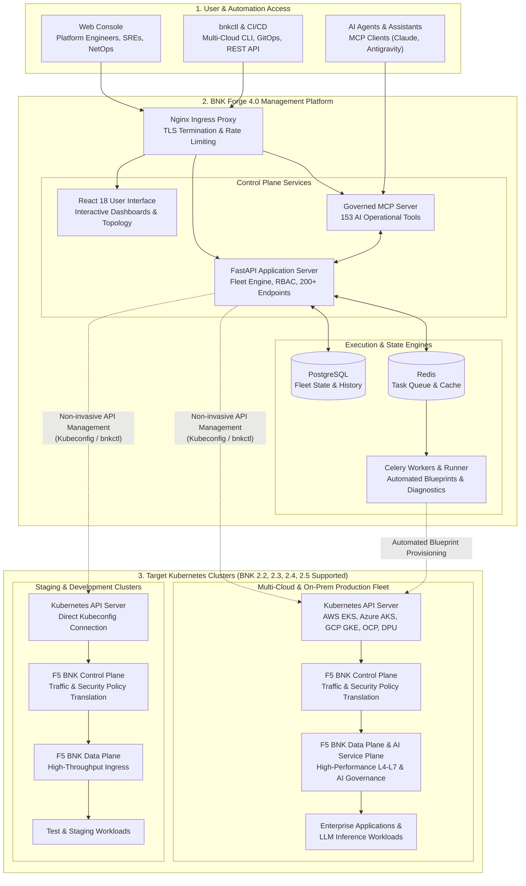

---

### Operational Lifecycle: Day 1 to Day 2

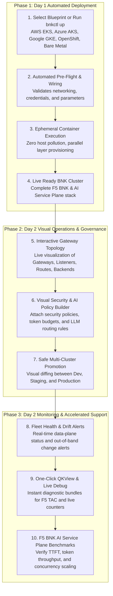

---

### Governed AI Operations (153 MCP Server Tools)

BNK Forge includes a dedicated Model Context Protocol (MCP) server that empowers AI assistants to interact with the platform under strict security and audit controls:

```mermaid
flowchart LR
    subgraph Agents["1. AI Assistants & Automation"]
        Claude["Anthropic Claude Desktop"]
        Gemini["Antigravity / Google AI"]
        CustomOps["Enterprise Autonomous Agents"]
    end

    subgraph SafetyGate["2. Governed MCP Server & Safety Gate"]
        Router["Tool Dispatcher\n153 Registered Tools"]
        
        subgraph RiskTiers["Enforced Risk Tiers"]
            TierRead["Read-Only Tier\nTopology, metrics, logs, health checks\nAuto-Approved"]
            TierMutate["Mutate Tier\nDeploy blueprint, update route, attach policy\nRequires Operator Role"]
            TierDestroy["Destructive Tier\nDelete cluster, purge config, rollback\nRequires Admin Confirmation"]
        end
        
        Audit["Immutable Audit Log\nOperator ID, timestamp, full payload"]
        Router --> RiskTiers
        RiskTiers --> Audit
    end

    subgraph ForgeEngine["3. BNK Forge Management Core"]
        RESTAPI["FastAPI 200+ REST Endpoints"]
        K8sEngine["Fleet & AI Service Plane Controller"]
        DiagEngine["Automated Diagnostic Engine"]
        
        RESTAPI --> K8sEngine
        RESTAPI --> DiagEngine
    end

    subgraph TargetFleet["4. Managed F5 BNK Fleet"]
        Clusters["Kubernetes Clusters\nAWS EKS, Azure AKS, GKE, OCP, Bare Metal"]
        BNKDeploy["F5 BNK & AI Service Plane\nSupported Releases: 2.2, 2.3, 2.4, 2.5"]
        
        K8sEngine --> Clusters
        DiagEngine --> BNKDeploy
    end

    Claude --> Router
    Gemini --> Router
    CustomOps --> Router
    Audit --> RESTAPI
```

---

## Quick Start

### Prerequisites

1. **[Docker](https://docs.docker.com/get-docker/)** with Docker Compose, and Git (for source builds).
2. **F5 BIG-IP Next for Kubernetes License & Registry Access** (required when deploying BNK onto target clusters):
   - Follow the [F5 BIG-IP Next for Kubernetes CloudDocs](https://clouddocs.f5.com/bigip-next-for-kubernetes/latest/overview.html) to obtain your F5 subscription JWT (`license.jwt`) and configure F5 Artifact Registry (`repo.f5.com`) pull credentials.

### Option A: Pre-Built Release Installer (Fastest)

Download the release bundle from [GitHub Releases](https://github.com/JLCode-tech/bnk-forge/releases) — pulls pre-built multi-arch (`linux/amd64`, `linux/arm64`) images from `ghcr.io/jlcode-tech`:

```bash
curl -sLO https://github.com/JLCode-tech/bnk-forge/releases/download/v4.0.0/bnk-forge-4.0.0.tar.gz
tar xzf bnk-forge-4.0.0.tar.gz
cd bnk-forge-4.0.0
./install.sh --local    # Laptop (macOS / Windows WSL2)
# OR: ./install.sh      # Linux Server (host networking)
```

### Option B: Build from Source

#### 1. Laptop (macOS / Windows WSL2)

```bash
git clone https://github.com/JLCode-tech/bnk-forge.git
cd bnk-forge
docker network create --driver bridge --subnet 10.200.0.0/24 bnk-forge-artifacts   # once per host
make local-deploy
```

Open **https://localhost** (or **http://localhost:8080**) in your browser.

#### 2. Linux Server

```bash
git clone https://github.com/JLCode-tech/bnk-forge.git
cd bnk-forge
docker network create --driver bridge --subnet 10.200.0.0/24 bnk-forge-artifacts   # once per host
make deploy
```

Access via **https://your-server-ip**.

---

### Initial Login & Password Rotation

| Field | Initial Value |
|---|---|
| **Username** | `admin` |
| **Password** | *Randomly generated on first startup* |

Retrieve your generated admin password from the backend container:

```bash
docker exec bnk-forge-backend cat /app/keys/initial_admin_password
```

*(You will be required to choose a new password upon first login.)*

---

### Prerequisite: the artifact runner network

BNK Forge's container-image engine runs each deployment artifact step in its own isolated container attached to a dedicated bridge network named **`bnk-forge-artifacts`**. Create it once per host:

```bash
docker network create --driver bridge --subnet 10.200.0.0/24 bnk-forge-artifacts
```

<details>
<summary><b>Why is this required? (Technical Details)</b></summary>

1. **Subnet Isolation:** Docker's auto-assigned IP pools can overlap with host VPNs or corporate subnets. Pinning a dedicated subnet prevents mid-deployment network collisions.
2. **Outside Compose:** On Linux servers, BNK Forge runs with `network_mode: host` for performance, which prevents Compose from declaring a bridge network in the same stack. The artifact network exists strictly for ephemeral runner containers.
3. **Subnet Customization:** You can define a custom CIDR via `ARTIFACT_NETWORK_SUBNET=<cidr>` or set `ARTIFACT_NETWORK_SUBNET=auto` in `.env`.
4. **Convenience:** Running `make deploy` or `make local-deploy` automatically invokes `make ensure-artifact-network` if it does not already exist.

</details>

---

## Common Commands

| Command | Description |
|---|---|
| `make local-deploy` | Build & start all containers on laptop (Docker Desktop / WSL2) |
| `make local-up` | Start existing laptop containers without rebuilding |
| `make local-down` | Stop laptop containers |
| `make local-logs` | Tail laptop container logs |
| `make deploy` | Build & start all containers on Linux server (host networking) |
| `make up` | Start existing server containers |
| `make down` | Stop server containers |
| `make server-logs` | Tail server container logs |
| `make status` | Check health and version of all running containers |
| `make upgrade-safe` | Preferred non-destructive server upgrade path with strict health pre-checks |
| `make mcp-readiness` | Verify MCP service liveness and runtime tool readiness |
| `make test` | Run entire test suite (backend, frontend, proxy, operator) |
| `make help` | Display full list of available targets |

---

## Configuration & First Steps

### 1. Configure the Module Library
To enable pre-packaged deployment blueprints after logging in:
1. Navigate to **Settings > Defaults**.
2. Set **Module Library Git URL** to: `https://github.com/JLCode-tech/bnk-forge-modules.git`
3. Set **Module Library Git Ref** to: `release/4.0` (or `release/2.2` for BNK 2.2 environments)
4. Go to **Settings > Environment Config** and click **Sync Modules**.

### 2. Connect Your Kubernetes Clusters
You can register clusters either automatically via [**`bnkctl up`**](https://github.com/JLCode-tech/bnkctl) (`forge.enabled: true` in `cluster.yaml`) or manually via kubeconfig:
1. Navigate to **Kubernetes > Clusters** (or **Cluster Fleet**).
2. Click **Add Cluster**.
3. Paste or upload your `kubeconfig` file.
4. BNK Forge will automatically discover namespaces, nodes, workloads, BNK resources, and **F5 BNK AI Service Plane** telemetry.

---

## Project Structure

```
bnk-forge/
├── backend/              # FastAPI REST backend & task workers (Python 3.11)
│   ├── routes/           #   200+ API endpoints (RBAC-enforced)
│   ├── services/         #   Business logic (BNK, K8s, AI Service Plane, Diagnostics)
│   ├── models/           #   SQLAlchemy database models
│   └── modules/          #   Python-defined deployment modules
├── frontend-v2/          # React 18 SPA (TypeScript + Vite + Tailwind + shadcn/ui)
│   └── src/
│       ├── components/   #   UI components & visual topology viewers
│       ├── pages/        #   Route pages (Command Center, Fleet, AI Service Plane, Benchmarks)
│       └── hooks/        #   React Query data hooks
├── mcp-server/           # Model Context Protocol server (153 governed AI tools)
├── proxy/                # Nginx reverse proxy (SSL, WebSocket, rate limiting)
├── scripts/              # Build, validation, and maintenance automation
├── docs/                 # Documentation hub & visual screenshots
├── docker-compose.yml    # Linux production stack (host networking)
├── docker-compose.local.yml # Laptop overlay (bridge networking with port publishing)
└── Makefile              # Platform-aware automation harness
```

---

## Curated Documentation Hub

| Guide | Description | Target Audience |
|---|---|---|
| [**F5 BIG-IP Next for Kubernetes CloudDocs**](https://clouddocs.f5.com/bigip-next-for-kubernetes/latest/overview.html) | Official F5 product documentation, architecture guides, and prerequisite setup | Platform Engineers, Architects, Operators |
| [**`bnkctl` Unified Multi-Cloud CLI**](https://github.com/JLCode-tech/bnkctl) | Pure-Go multi-cloud provisioning, healing, benchmarking, and Forge integration CLI | Cloud & Platform Engineers, SREs |
| [**DevCentral Technical Reference**](docs/DEVCENTRAL_OVERVIEW.md) | Technical architecture, Gateway API topology, diagnostic tooling, and operational reference | Platform Engineers, SREs, NetOps, TAC |
| [**User Guide**](docs/USER_GUIDE.md) | Complete walkthrough of all UI features, workflows, and configuration options | Platform Engineers, Operators, Administrators |
| [**API Reference**](docs/API_REFERENCE.md) | Full catalog of 200+ REST API endpoints with request/response schemas | DevOps, Automation Engineers, Developers |
| [**Installation Guide**](docs/INSTALLATION.md) | Detailed installation steps for laptop, bare-metal, VM, and cloud environments | Systems Administrators, DevOps |
| [**Production Deployment**](docs/DEPLOYMENT.md) | Best practices for hardening and sizing production deployments | Infrastructure Architects, SREs |
| [**Troubleshooting Runbook**](docs/TROUBLESHOOTING.md) | Common error signatures, resolution steps, and diagnostic procedures | Operators, Support Engineers |
| [**Server Upgrade Runbook**](docs/UPGRADE_RUNBOOK.md) | Step-by-step procedures for non-destructive platform upgrades | Platform Administrators |
| [**Testing Guide**](docs/TESTING.md) | Test architecture, test suites, and validation standards | Contributors, Developers |
| [**Docker Architecture**](docs/DOCKER.md) | Multi-target Dockerfile design, image verification, and supply chain | Security & DevOps Engineers |
| [**Disk Management**](docs/DISK_MANAGEMENT.md) | Managing Docker storage, image cache, and scheduled cleanup | System Administrators |
| [**AWS SSO Setup**](docs/AWS_SSO_SETUP.md) | Configuring enterprise AWS IAM Identity Center authentication | Security & Cloud Architects |
| [**BlueField-3 DPU Provisioning**](docs/DPU_PROVISIONING_GUIDE.md) | Bare-metal provisioning with NVIDIA BlueField-3 SmartNICs | Hardware & Network Engineers |
| [**Module & Blueprint Authoring**](docs/How%20to%20write%20CI%20container%20runner%20modules%20and%20blueprints%20for%20BNK%20Forge.md) | Creating custom reusable runner modules and blueprints | Automation Engineers, Contributors |
| [**Product Vision**](docs/PRODUCT_VISION.md) | Long-term architectural direction and platform strategy | Product Managers, Architects |
| [**Platform Roadmap**](docs/ROADMAP.md) / [HTML View](docs/roadmap.html) | Completed milestones, active priorities, and planned features | Community, Customers, Engineering |

---

## Version Compatibility Matrix

| BNK Forge Release | Supported F5 BNK Releases | Module Library Ref | Gateway API Version | Kubernetes Versions | Support Status |
|---|---|---|---|---|---|
| **4.0.0** | **2.2, 2.3, 2.4, 2.5** | `release/4.0` | v1.1+ (Standard Channel) | 1.28 – 1.32 | **Active (Current Release)** |
| 3.x | 2.2, 2.3 | `release/2.2` | v1.0+ | 1.26 – 1.30 | Maintained |
| 2.x | 2.2 | `release/2.2` | v1.0 | 1.24 – 1.28 | Legacy |

---

## License & Governance

* **License**: Licensed under the [Apache License, Version 2.0](LICENSE).
* **Contributing**: Please review [CONTRIBUTING.md](CONTRIBUTING.md) and [docs/DEVELOPMENT.md](docs/DEVELOPMENT.md).
* **Code of Conduct**: See [CODE_OF_CONDUCT.md](CODE_OF_CONDUCT.md).
* **Security Policy**: See [SECURITY.md](SECURITY.md) for vulnerability disclosure procedures.
