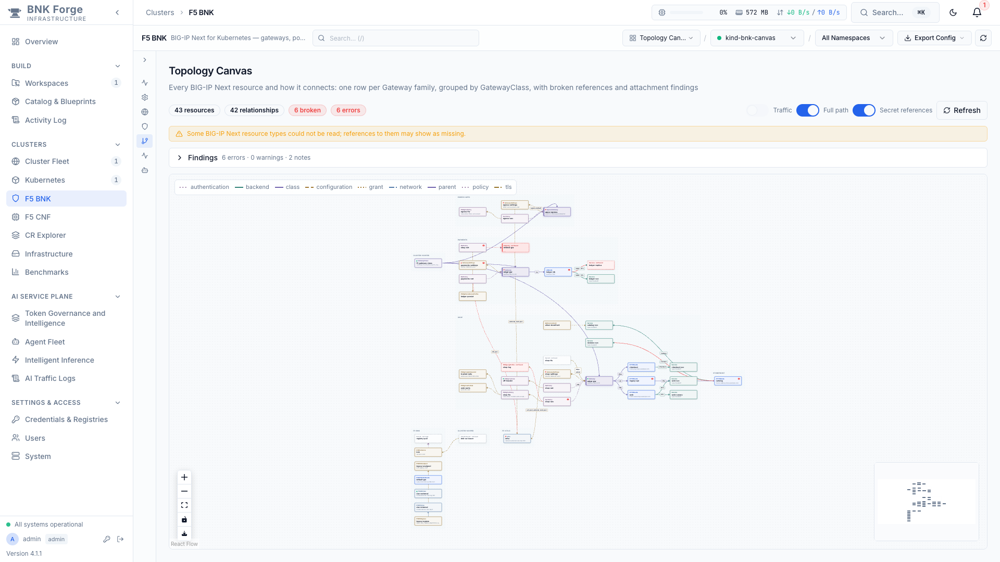
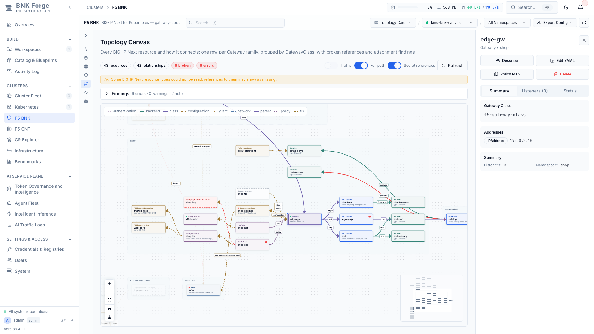
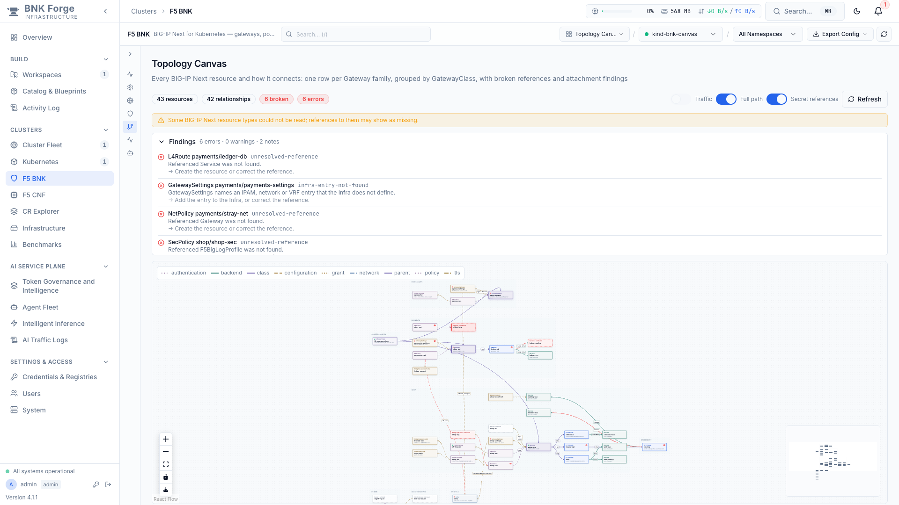
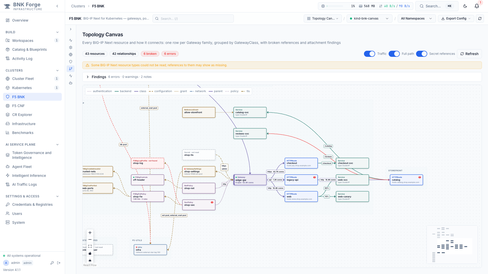
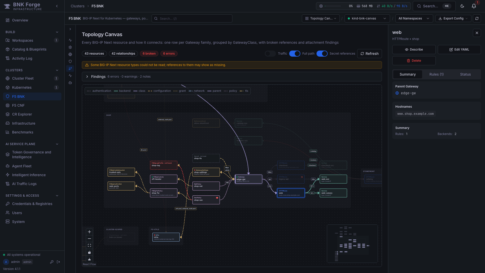

# Topology Canvas

The Topology Canvas draws every BIG-IP Next for Kubernetes resource in a cluster and how they connect. It shows Gateway families, routes, Services, inference pools, policies, TLS, configuration and the data plane, with broken references and attachment problems marked on the graph.

Gateways of other controllers, such as Istio or NGINX Gateway Fabric, are drawn too, each in its own GatewayClass band. This lets you compare BIG-IP Next with them side by side on one cluster. Turn off **Other controllers** to see BIG-IP Next only.

It complements the **Object Topology Graph**, a collapsible tree of the same resources. The tree is good for reading one Gateway's details. The Canvas is better for seeing the whole cluster at once and following references across namespaces.

The Canvas is ported from [Gateway Atlas](https://github.com/tareqaminul/gateway-atlas-guide) (Apache-2.0) by its author. Each ported file names its origin.

## Opening the Canvas

You can open it three ways:

- **Sidebar:** F5 BNK → *Topology & Insights* → **Topology Canvas**.
- **View picker:** choose **Topology Canvas** in the F5 BNK header.
- **Deep link:** `/bnk?view=view-canvas`. The short form `?view=canvas` also works.

The cluster and namespace pickers in the header apply as they do on every BNK view. With a namespace selected, the Canvas also keeps the resources that namespace depends on in other namespaces. For example, it keeps a route's parent Gateway, a ReferenceGrant, or a Service in another namespace.

## Reading the Canvas

### Layout

- **One row per traffic family.** A row starts at an entry point (a Gateway or EgressGateway) and runs left to right in the direction of traffic. The GatewayClass sits above its Gateways, then come routes, then Services.
- **Bands per GatewayClass.** Families that share a class are grouped together, so each controller gets its own band.
- **Support cards around the family.** Policies, TLS Secrets and configuration sit beside the card they attach to, in fixed lanes. Policies and TLS go to the left of their target. Configuration, ReferenceGrants and networking go to the right of their source.
- **Shared and cluster-scoped resources.** A Service used by several routes is placed between them. Cluster-scoped resources, such as a GatewayClass, get their own "cluster-scoped" tiles.
- **Namespaces as frames.** Each namespace is drawn as a dashed frame. Namespaces without a Gateway, such as the BNK system namespaces with CNEInstance, SNAT pools, VLANs and static routes, are packed below the families.

### Cards

Each card shows the resource kind, a readiness dot, the name and one key fact. The dot reflects the first condition the resource reports: `Programmed`, `Accepted` or `Ready`. The fact is a listener address, route hostnames, a Service type, VLAN tags, and so on. Hover over a card to see all its facts.

| Card | Meaning |
|------|---------|
| Solid border | The resource exists in the cluster. |
| Red badge with a number | The resource has that many error findings; amber means warnings. |
| Red dashed border, "· not found" | Something references this resource and it does not exist. |
| Grey dashed border, "· not read" | A reference to a kind the Canvas never reads, such as a Secret or ClusterIssuer. It is not checked, so it is not marked broken. |

### Relationships

Lines are typed by colour and dash pattern. The legend in the canvas lists the types present in the current graph.

| Relationship | From → to |
|--------------|-----------|
| `class` | GatewayClass → Gateway |
| `parent` | Gateway → route (`parentRefs`). The label is the listener (`sectionName`). |
| `backend` | Route → Service or InferencePool. The label is the path match and weight, for example `/api · 75%`. |
| `endpoint-picker` | InferencePool → its Endpoint Picker Service (`endpointPickerRef`). The label is the port. |
| `policy` | NetPolicy, SecPolicy or AppPolicy → target Gateway or listener |
| `tls` | Secret → Gateway listener (Secret metadata only) |
| `configuration` | Resource → its settings and extensions: GatewaySettings, F5BnkGateway, Infra, firewall policies, iRules, address and port lists, SNAT pools. Also F5EPP → the InferencePool it picks endpoints for. |
| `grant` | ReferenceGrant → each object it authorizes across namespaces |
| `network` | F5SPKEgress → the VLAN its VXLAN uses |
| `logging` | Resource → log profile, for example F5SPKEgress → F5BigLogProfile |
| `authentication` | CNEInstance → its image pull Secret (metadata only) |

A red line is a broken reference. Lines that only restate their type have no label; select either end to see every label.

### Inference (Gateway API Inference Extension)

An HTTPRoute can send traffic to an **InferencePool** instead of a Service. The pool card sits in the Service column. Its facts show the model-server selector, target ports, protocol and the Endpoint Picker's failure mode. Its readiness dot combines the conditions every parent Gateway reports, so it is green only when all of them accept the pool.

The pool's **Endpoint Picker** Service hangs off it with an `endpoint-picker` line. An **F5EPP**, F5's Endpoint Picker for BIG-IP Next, points at the pool it serves; its card shows the engine, mode and replicas. A wrong Endpoint Picker port is reported as `service-port-not-found`.

## Selecting a card

Clicking a card opens Forge's resource detail panel on the right, with Describe, Edit YAML, Policy Map and Delete. It is the same panel the Object Topology Graph uses. Placeholders and Secrets open nothing.

When a card is selected, the canvas highlights its **full traffic path** and dims everything else. The path covers:

- everything upstream and downstream of the card along class, parent and backend links;
- the policies, TLS and configuration attached to that chain;
- what those configure in turn.

A policy that also targets another Gateway does not pull that Gateway's family in. Selecting a policy or other support card traces every chain it is attached to.

Turn off **Full path** to highlight only the card's direct relationships, as Gateway Atlas does. Press **Escape** or click the background to clear the selection.

## Findings

The **Findings** strip lists what the Canvas found wrong, sorted by severity. Click a resource name to select it on the canvas.

| Rule | What it means |
|------|---------------|
| `unresolved-reference` | A reference names a resource that does not exist. |
| `missing-reference-grant` | A cross-namespace reference has no ReferenceGrant allowing it. |
| `service-port-not-found` | A backendRef names a port that the Service does not expose. |
| `route-no-valid-parent` | No parentRef of a route resolves to a listener that accepts it. |
| `parent-listener-not-found` | A parentRef's `sectionName` or `port` matches no listener. |
| `listener-namespace-not-allowed`, `listener-kind-not-allowed`, `listener-hostname-mismatch` | A listener's `allowedRoutes` or hostname rules reject the route. |
| `policy-section-not-found` | A policy targets a listener (`sectionName`) the Gateway does not have. |
| `infra-not-found`, `infra-entry-not-found` | GatewaySettings names an Infra, or an IPAM, network or VRF entry in it, that does not exist. |
| `egress-config-not-found` | An egress names configuration that does not exist. |
| `listener-no-routes` *(note)* | A listener has no route attached. |
| `listener-namespace-unverified` *(note)* | A listener admits routes by namespace label, which the Canvas cannot check because it does not read Namespaces. |
| `soft-reference-absent`, `reference-not-inspected` *(notes)* | The reference is resolved by the controller later, or is to a kind the Canvas does not read. |

## Traffic counters

When Forge can read TMM counters for the cluster, the **Traffic** switch puts them on the canvas:

- **Gateways:** open connections and total connections, summed over their listeners;
- **route edges:** each listener's total connections next to its name, for example `https · 42.7K conns`;
- **EgressGateways and F5SPKEgress:** open and total connections;
- **F5BigFwPolicy cards:** total rule hits and the number of rules.

The counters are the same `trafficStats` the Traffic Flow and Object Topology views use. They come from the BNK data that the F5 BNK page already loads, so the Canvas makes no extra cluster calls for them. Forge reads them from a TMM debug sidecar. On clusters without one, the switch is disabled and its tooltip gives the reason.

*In this screenshot the counters are injected sample values: the anonymized kind lab used for these screenshots runs no TMM.*

## Toolbar and controls

| Control | What it does |
|---------|--------------|
| **Traffic** | Show or hide TMM counters. Disabled when none are available. |
| **Full path** | Highlight the selected card's whole traffic chain, or only its neighbours. |
| **Other controllers** | Also draw Gateways of other controllers (Istio, NGINX and so on) and their routes. On by default; off shows BIG-IP Next only. |
| **Secret references** | Show or hide the Secret placeholder cards. |
| **Refresh** | Re-read the cluster, bypassing the 60-second BNK data cache. The canvas does not poll, so the layout only changes on Refresh or a namespace switch. |
| Zoom, fit, lock | The standard canvas controls, bottom left. |
| **Save as SVG** (download icon) | Save the whole graph, not just the visible part, as a standalone vector file in the current theme. |
| Minimap | Bottom right. Drag or scroll it to move around large clusters. |

The Canvas follows Forge's light and dark themes:

## Data and safety

- **Read-only.** The Canvas reads from `GET /api/k8s/clusters/{id}/f5bnk/canvas?controllers=all|bnk` (viewer role), which only gets and lists resources. It reuses the BNK data fetch and its cache. It also lists F5BnkGateways itself, because Forge's resource registry does not include them. If that CRD is not installed or the kubeconfig may not list it, references to F5BnkGateways stay "not read".
- **Secrets.** Secrets are never read by the Canvas. Secret cards are built from the objects that reference them, so they carry only kind, namespace and name. Passive Overview and Canvas loads also avoid reading CWC mTLS or auth token Secrets unless a CWC client pod is already running or the user explicitly opens the Licensing tab or clicks Refresh.
- **Partial reads.** If some resource types could not be read (for example due to RBAC `403 Forbidden`), a banner says so, and references to those types may appear as missing. Optional CRDs that are not installed on the cluster (`404 Not Found`) are treated as absent rather than failed reads.
- **RBAC requirements.**
  - *Topology & configuration viewing (read-only kubeconfig):* requires `get` and `list` on core `namespaces`, `pods`, `services`, `configmaps`, `events`, `nodes`, `persistentvolumeclaims`, `apps/v1` workloads, `networking.k8s.io/v1` `networkpolicies`, `gateway.networking.k8s.io` resources, `inference.networking.k8s.io` (`inferencepools`), `k8s.cni.cncf.io` (`network-attachment-definitions`), `cert-manager.io` (`certificates`, `issuers`, `clusterissuers`), and installed F5 BNK CRDs (`k8s.f5.com`, `k8s.f5net.com`, `gateway.k8s.f5net.com`, `ai.k8s.f5net.com`). No `secrets` read or write verbs are required.
  - *TMM traffic counters (optional):* requires `get` and `list` on `pods` plus `create` on `pods/exec` for `f5-tmm` pods (container `debug`) in the BNK data-plane namespace. Without `pods/exec`, the **Traffic** toggle is disabled with a read-only tooltip and the Canvas continues to render normally.
  - *CWC licensing & QKView (optional, on-demand):* requires `get` and `list` on `services`, `pods`, and `secrets`, plus `create` on `pods` and `pods/exec` in the CWC namespace (typically `f5-utils`). With a read-only kubeconfig, licensing views report read-only access without failing the page.

## Limitations

- The Canvas stops at Services. It does not read Deployments, Pods or NetworkAttachmentDefinitions; network attachments appear as card facts.
- Namespace-label `allowedRoutes` selectors are reported as notes, not checked.
- These Gateway Atlas features are not ported:
  - the Classic layout;
  - the compact mode and folded columns;
  - the hover popover;
  - camera persistence.
- Closing the detail panel leaves the card selected until you press Escape or click the background.

## For developers

| Part | Where |
|------|-------|
| Graph builder (pure, table-tested) | `backend/services/bnk/canvas_graph.py` |
| Builder tests and golden file | `backend/tests/unit/test_bnk_canvas_graph.py` (`UPDATE_GOLDEN=1` regenerates) |
| Endpoint | `backend/routes/k8s/f5bnk.py`, `GET /f5bnk/canvas`; Canvas-only lists in `backend/services/bnk/canvas_fetch.py` |
| Frontend | `frontend-v2/src/components/k8s/bnk-canvas/` |
| Frontend tests | `frontend-v2/src/components/k8s/bnk-canvas/__tests__/` (ported Atlas layout tests, view tests with MSW) |
| Local lab | [atlas-canvas/seed-kind.sh](atlas-canvas/seed-kind.sh) seeds a kind cluster with the anonymized fixture |

The frontend files are:

- **Ported from Atlas:** `familiesLayout.ts` (Families layout), `hierarchy.ts` (relationship placement and tiers), `edgeStyles.ts` (line styles), `edgeLabels.ts` (label placement), `packing.ts` (skyline packing).
- **Forge additions:** `tracePath.ts`, `trafficOverlay.ts`, `exportSvg.ts`.
- **Views:** `BnkCanvas.tsx` (reactflow v11 renderer) and `F5BNKCanvasView.tsx` (toolbar and findings).

The design and its decisions are in [atlas-canvas/PLAN.md](atlas-canvas/PLAN.md). Issues in existing Forge code found along the way are in [atlas-canvas/FORGE-FINDINGS.md](atlas-canvas/FORGE-FINDINGS.md).
