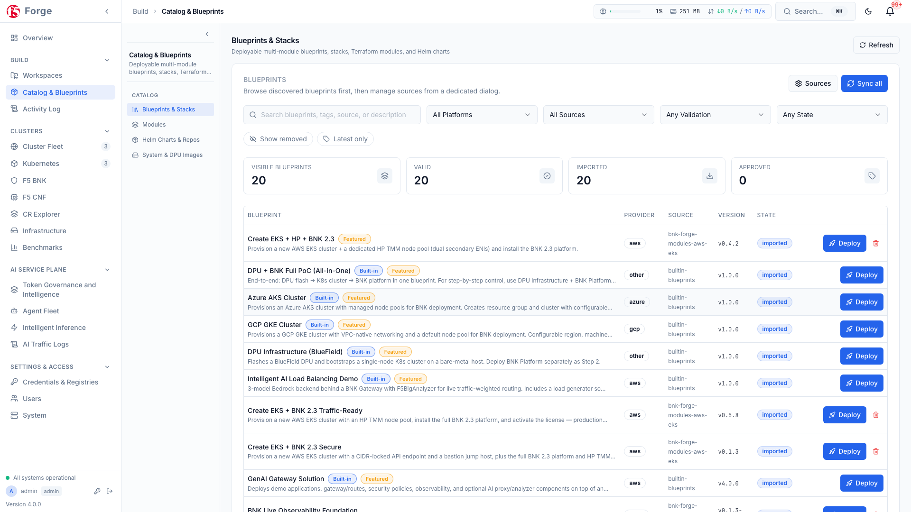
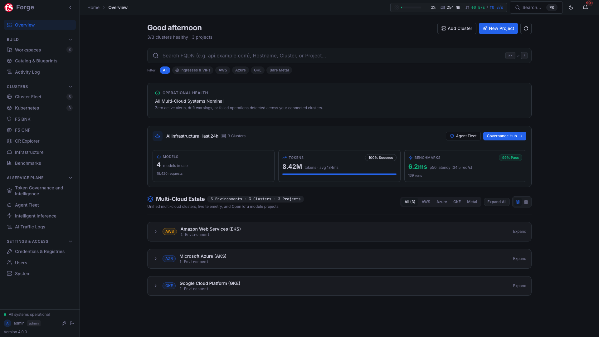

# BNK Forge — User Guide

Complete guide to using BNK Forge for deploying and managing F5 BIG-IP Next for Kubernetes infrastructure.

---

## Table of Contents

- [Getting Started](#getting-started)
- [Navigation](#navigation)
- [Command Center (Dashboard)](#command-center-dashboard)
- [Projects](#projects)
- [Project Detail](#project-detail)
- [Modules](#modules)
- [Blueprints](#blueprints)
- [Deployments](#deployments)
- [Operations Log](#operations-log)
- [Kubernetes](#kubernetes)
- [Helm Operations](#helm-operations)
- [F5 BNK](#f5-bnk)
- [Fleet Management](#fleet-management)
- [AI Service Plane](#ai-service-plane)
- [Performance Benchmarks](#performance-benchmarks)
- [Auth Templates](#auth-templates)
- [User Management](#user-management)
- [System Administration](#system-administration)
- [Backup & Restore](#backup--restore)
- [Step-by-Step Operational How-To Workflows](#step-by-step-operational-how-to-workflows)
- [Keyboard Shortcuts](#keyboard-shortcuts)

---

## Getting Started

### Login

Navigate to the BNK Forge URL in your browser. You'll see a two-panel login screen.

1. Enter your **Username** and **Password**
2. Click **Sign In**
3. On first login, you'll be prompted to change your default password

### Roles

BNK Forge has three user roles:

| Role | Access |
|------|--------|
| **Admin** | Full access — system settings, user management, all projects |
| **Operator** | Deploy and manage own projects, access auth templates |
| **Viewer** | Read-only access to all pages |

### Key Concepts

| Concept | Description |
|---------|-------------|
| **Project** | A container for related infrastructure modules and K8s clusters |
| **Module** | A reusable infrastructure component (OpenTofu/Terraform module) |
| **Blueprint** | A pre-packaged collection of modules with correct ordering |
| **Cluster** | A Kubernetes cluster connected via kubeconfig |
| **Fleet** | All clusters monitored across projects |

---

## Navigation

The sidebar organizes features into workflow sections:

### OVERVIEW
- **Overview** (`/`) — Platform overview, fleet health, AI infrastructure telemetry & quick actions

### BUILD
- **Workspaces** (`/projects`) — IaC workspaces, modules, variables & state (shows project count + drift badge)
- **Catalog & Blueprints** (`/catalog`) — Deployable blueprints, stacks, modules & Helm charts
- **Activity Log** (`/tasks`) — Global task queue, execution logs & history (shows in-progress count + status dot)

### CLUSTERS
- **Cluster Fleet** (`/fleet`) — Multi-cluster health, comparison, promotion & lifecycle
- **Kubernetes** (`/kubernetes`) — Single-cluster workloads, networking, storage & CRDs
- **F5 BNK** (`/bnk`) — BIG-IP Next for Kubernetes — Gateway, BGP/BFD, CGNAT & Security
- **F5 CNF** (`/cnf`) — Cloud-Native Network Functions — DNS, Telco & L4/L7
- **CR Explorer** (`/crds`) — Browse Custom Resource Definitions, schemas & live instances
- **Infrastructure** (`/infrastructure`) — Bare-metal hosts, NVIDIA BlueField DPUs & topology
- **Benchmarks** (`/benchmarks`) — Cluster network & data-plane performance benchmarks

### AI SERVICE PLANE
- **Token Governance and Intelligence** (`/ai/token-governance`) — F5 BNK AI Service Plane token telemetry, virtual keys, budgets & tenant governance
- **Agent Fleet** (`/ai/agents`) — Autonomous AI agents, identities & policies
- **Intelligent Inference** (`/ai/llm-router`) — SmartLLM traffic routing, failover & model endpoints
- **AI Traffic Logs** (`/ai/logs`) — AI request audit trail, latency & token telemetry

### SETTINGS & ACCESS
- **Credentials & Registries** (`/access-methods`) — SSH keys, cloud credentials & container registries
- **Users** (`/users`) — User accounts & role assignments (admin only)
- **System** (`/system`) — Platform health, backups, upgrades & configuration (admin only)

The sidebar can be collapsed for more screen space. Sidebar badges show live counts and status indicators (drift count on Workspaces, task status dot on Activity Log).

---

## Command Center (Dashboard)

The Overview / Command Center (`/`) is the home page providing a unified summary of your multi-cloud infrastructure, **F5 BNK AI Service Plane** telemetry, and recent benchmark activity.


*Light theme view:*


### Greeting and Quick Actions

- Dynamic greeting (Good morning/afternoon/evening)
- Contextual subtitle showing active operations, drift status, or fleet summary
- **Add Cluster** button — opens the cluster addition flow
- **New Project** button — navigates to project creation

### Fleet Health Overview

When clusters exist, a Fleet Health card shows:
- Total cluster count
- Status pills: healthy (green), warning (amber), critical (red), offline (grey)
- Mini-cards per cluster showing: name, BNK version, TMM count, route count, status

### Active Operations

Real-time display of in-progress deployments, showing task type, module name, project, and elapsed time. Click to navigate to the project.

### Attention Needed

Aggregated alerts requiring action:
- **Unhealthy clusters** — critical/warning clusters from fleet health
- **Offline operators** — clusters with connectivity issues
- **Drift detected** — modules with infrastructure drift, showing resource change counts (+add, ~change, -destroy) with **Review Changes** and **Reconcile** buttons
- **Failed deployments** — recent failures with error messages and **View Error** links

### Projects & Clusters Cards

Side-by-side lists showing:
- **Projects**: name, region, deployment count, drift badge. Click to open project.
- **Clusters**: name, provider, BNK version, TMM count, fleet status. Click to open Kubernetes page.

### Stats Row

- **Health Ring** — animated donut chart (green ≥80, amber ≥60, red <60)
- **6 Stat Cards**: Projects, Clusters, Fleet, Active Ops, Drift, Modules

### Recent Operations

Activity feed showing the latest deployment operations with status, module, project, and time.

### Blueprints

Featured blueprint cards. Click to view details and deploy.

### Value Journey Banner

Tracks a guided workflow: Deploy → Validate → Benchmark → Diagnose → Export. Progress bar with step indicators. Click steps to navigate. Export a readiness report when complete.

---

## Projects

### Projects List (`/projects`)

A sidebar + content layout for managing projects.

**Sidebar Filters:**
- All Projects / My Projects (ownership filter)
- Status: Active, Inactive, Has Failures
- Quick Stats: Total Modules, Deployed count

**Project Table Columns:** Name/description, status, type/location (AWS/Azure/GCP/K8s + region), modules (with deployed/failed/drift counts), last activity, actions menu.

**Actions:**
- **New Project** — opens create dialog with fields: Name, Description, Project Type (AWS/Azure/GCP/On-Premises (Bare Metal / VM))
- Click any row to open the project detail page

---

## Project Detail

### Project Detail (`/projects/:id`)

The project detail page has a header bar, stats, and tabbed content.

**Header:**
- Project name, location badge, backend type badge (S3/Local), owner badge
- "View only" badge for non-owners

**Header Buttons (owner only):**
- **Add Module** — add an IaC module from the catalog
- **Credentials** — assign cloud credentials (AWS projects)
- **Settings** — edit project configuration
- **Save as Template** — save current module set as a reusable blueprint
- **Deploy All** — parallel deploy all modules with layer visualization
- **Destroy All** — parallel destroy all modules in reverse order
- **Transfer Ownership** — transfer to another user
- **Delete** — delete project with confirmation

**Stats Bar:** Module count, health %, drift count, K8s cluster count.

### Tabs

| Tab | Description |
|-----|-------------|
| **Modules & Blueprints** | Module table with standalone modules and blueprint groups. Per-module actions: Init, Plan, Apply, Edit Variables, Recover State, Destroy, Delete. Dependency pipeline visualization. Project variables editor. |
| **Secrets** | Manage file and value secrets required by modules. Badge shows missing secret count. |
| **K8s Clusters** | List and manage Kubernetes clusters attached to the project. Auto-detect mode for EKS clusters. |
| **Drift** | Configure drift detection settings and view drift check history. |
| **Snapshots** | View, create, diff, and restore state snapshots. |

### Module Detail Panel

When a module is selected, a detail panel shows four sub-tabs:
- **Outputs** — key-value list of module outputs
- **State** — resource count, serial, terraform version, state location
- **Variables** — variable overrides
- **Logs** — link to task history

### Parallel Execution

When deploying all modules, the system organizes them into dependency layers. Modules in the same layer deploy concurrently. A visual pipeline shows layer progress. Destroy executes layers in reverse order.

---

## Modules

### Module Catalog (`/modules`)

Browse, import, and manage OpenTofu/Terraform modules.

**Features:**
- Browse by source repository (modules grouped by source)
- Filter by cloud provider (AWS, GCP, Azure)
- Card grid or table view toggle
- Click any module for a detail panel showing description, inputs, outputs, and dependencies

**Module Sources:**
- Configure multiple Git source repositories with sync status
- Manual sync button per source
- Add custom modules from any Git URL

**Registry Import:**
- Browse OpenTofu/Terraform Registry
- Search by name, filter by provider
- Click **Import** to add to your catalog

---

## Blueprints

### Catalog & Blueprints (`/catalog` / `/stacks`)

Pre-packaged module collections for common deployment patterns.



**Features:**
- Browse by category: Infrastructure, BNK, Solution, Custom
- Each blueprint shows: name, description, cloud provider, modules included
- Click a blueprint for details, then **Deploy to Project** to create a new project with pre-configured modules
- **Duplicate Template** — create a copy
- **Import/Export** — share templates between instances
- **Save from Project** — save any working project as a new blueprint (via project detail → Save as Template)

---

## Deployments

### Deployment Workflow

Each module follows this lifecycle:

```
Initialize → Plan → Apply → (Running) → Destroy (when done)
```

| Operation | Description |
|-----------|-------------|
| **Initialize** | Downloads providers, initializes backend and workspace (`tofu init`) |
| **Plan** | Shows what will be created/modified/destroyed — no changes made (`tofu plan`) |
| **Apply** | Executes the plan, provisions resources, captures outputs (`tofu apply`) |
| **Destroy** | Removes all resources created by the module (`tofu destroy`) |

### Module States

| State | Meaning |
|-------|---------|
| `not_initialized` | Module added, not yet initialized |
| `initialized` | Ready for plan/apply |
| `planning` | Plan in progress |
| `planned` | Plan complete, ready to apply |
| `applying` | Apply in progress |
| `applied` | Successfully deployed |
| `destroying` | Destroy in progress |
| `destroyed` | Resources removed |
| `failed` | Last operation failed |

### Deploy All (Parallel Execution)

1. Open a project with multiple modules
2. Click **Deploy All**
3. Review the execution plan showing dependency layers
4. Monitor real-time progress per layer

Independent modules deploy concurrently. Dependent modules wait for their dependencies.

---

## Operations Log

### Task History (`/tasks`)

View deployment history across all projects.

- Filterable task list with status indicators
- Real-time status indicator in sidebar (green = success, blue pulse = running, red = failed)
- Click any task to view full execution logs, start/end times, status, and result

---

## Kubernetes

### Kubernetes Explorer (`/kubernetes`)

A sidebar + content layout for managing Kubernetes resources across clusters.

**Header Controls:**
- Project selector, Cluster selector, Namespace filter
- Search input (press `/` to focus)
- Refresh button, Detailed/Compact view toggle

### Sidebar (7 sections, 27 resource types)

| Section | Resources |
|---------|-----------|
| **Workloads** | Pods, Deployments, StatefulSets, DaemonSets, ReplicaSets |
| **Networking** | Services, Ingresses |
| **Gateway API** | Gateway Classes, Gateways, HTTP Routes, GRPC Routes, TCP Routes, UDP Routes, TLS Routes, Reference Grants |
| **Config & Storage** | ConfigMaps, Secrets, PVCs |
| **Cluster** | Nodes, Namespaces, CRDs, Storage Classes, Persistent Volumes |
| **cert-manager** | Certificates, Cluster Issuers, Issuers |
| **Helm** | Releases, Chart Browser |

Additional sidebar buttons:
- **Export Config** — download full cluster config as YAML
- **Cluster Scan** — run a health assessment (prerequisites: cert-manager, Multus, SR-IOV, HugePages, storage classes)

### Resource Operations

| Operation | Available On | Description |
|-----------|-------------|-------------|
| **Describe** | All resources | View `kubectl describe` output |
| **Edit YAML** | All resources | Edit resource YAML in-place |
| **Delete** | All resources | Delete with confirmation |
| **Logs** | Pods | Stream/view pod logs with container selector |
| **Terminal** | Pods | Interactive shell session via WebSocket |
| **Restart** | Pods | Delete pod so controller recreates it |
| **Scale** | Deployments | Change replica count |
| **Rollout** | Deployments, StatefulSets, DaemonSets | Manage rollouts (history, restart, undo) |
| **Node Ops** | Nodes | Cordon, uncordon, drain operations |
| **Create** | All types | Create new resource from YAML (with dry-run) |

### Add a Cluster

1. Click **Add Cluster** (from dashboard, fleet, or kubernetes page)
2. Select a project (or create a new one)
3. Provide: Name, Kubeconfig (paste or upload)
4. Save — the cluster appears in your cluster selector

EKS clusters deployed via modules can also be auto-detected.

---

## Helm Operations

Helm is integrated into the Kubernetes page under the **Helm** sidebar section.

### Releases

View all installed Helm releases with: release name, namespace, chart, version, status, revision, and last updated.

**Per-Release Actions:**
- **View** — details panel with values, notes, and revision history
- **Upgrade** — update to new chart version or change values
- **Rollback** — revert to a previous revision
- **Uninstall** — remove the release

### Chart Browser

Browse charts from configured Helm repositories. Search by name, then **Install** with:
- Release Name, Namespace, Version, custom Values YAML

### Repository Management

- **Add Repository** — quick-add popular repos (bitnami, ingress-nginx, jetstack, prometheus, grafana, etc.) or enter custom URL
- **Update All** — refresh chart lists
- **Remove** — delete a repository

---

## F5 BNK

### F5 BNK Explorer (`/bnk`)

A comprehensive sidebar + content layout for managing F5 BIG-IP Next for Kubernetes resources.


**Header Controls:**
- Project selector, Cluster selector, Namespace filter
- Search input (press `/` to focus)
- Refresh button, Resource count badge
- **Export Config** dropdown — export as YAML or JSON

### Sidebar (7 sections, 38 items)

#### Insights (8 views)

| View | Description |
|------|-------------|
| **Traffic Flow** | Visual diagram of how traffic flows through BNK — clickable resource nodes |
| **Health Dashboard** | Real-time health for all BNK platform components. Auto-refreshes every 30 seconds. |
| **Gateway Topology** | Interactive graph visualization of gateways → routes → backends |
| **Topology Canvas** | Every BIG-IP Next resource and how it connects: Gateway families, policies, TLS, configuration and data plane, with broken references, attachment findings, traffic counters, path tracing and SVG export. See [TOPOLOGY_CANVAS.md](TOPOLOGY_CANVAS.md). |
| **Policy Gateway Map** | Security policies mapped to gateway listeners |
| **AI Analyzers** | AI load balancing and telemetry analyzers for LLM inference |
| **Upgrade** | BNK version upgrade panel with pre-flight checks, rolling execution, and rollback |
| **Diagnostics** | Tabbed panel with 5 diagnostic tools (see below) |

#### Diagnostics (5 sub-tabs within the Diagnostics view)

| Tab | Description |
|-----|-------------|
| **Runbooks** | Automated diagnostic runbooks — step-by-step sequences for common BNK problems |
| **QKView** | Collect, list, monitor, and download BNK diagnostic tarballs from CWC |
| **Licensing** | View license status, telemetry report, activate licenses, download receipts |
| **TMM Debug** | Execute debug commands against TMM sidecar: `tmctl` (traffic stats), `configview` (CR config), `bdt_cli` (networking: ARP, routes, connections) |
| **Recovery** | Post-reboot recovery: CWC certificate re-sync and platform restart (controller, FLO, TMM) |

#### Build (2 views)

| View | Description |
|------|-------------|
| **Configuration Builder** | Multi-step wizard to create complete Gateway configurations (listeners, routes, security, network policies) |
| **Policy Builder** | Visual creation and attachment of security/network policies to gateway listeners |

#### Traffic Management (8 items)

Backends (service cross-reference view), Gateway Classes, Gateways, HTTP Routes, GRPC Routes, TCP Routes, UDP Routes, TLS Routes

#### Security (7 items)

Firewall Policies, Firewall Rule Lists, Security Policies, Network Policies, DDoS Protection, Address Lists, Port Lists

#### Networking (5 items)

VLANs, Static Routes, SNAT Pools, Egress Config, iRules

#### Logging & Telemetry (2 items)

HSL Publishers, Log Profiles

#### System (6 items)

CNE Instances, BNK Gateway (IPAM), IPAM Ranges, Global Options, L4 Routes, Reference Grants

### Resource Operations

All resource types support: **Describe**, **Edit YAML** (with dry-run), **Delete**, and **Create** (from YAML). Many resource types have additional context-specific actions (e.g., "View Policies" for Gateways, "View Code" for iRules).

### Detail Panel

Clicking any resource opens a right-side detail panel with resource-specific information. 22 resource kinds have dedicated detail components showing structured data (e.g., Gateway listeners, HTTPRoute rules, firewall rules, VLAN config).

---

## Fleet Management

### Fleet (`/fleet`)

Monitor fleet health across all connected Kubernetes clusters.

**Layout:** Sidebar with two views — **Overview** and **DPU Infrastructure**.

### Overview

**Aggregate Stats:** Total clusters, Healthy, Warning, Critical, Offline.

**Cluster Table** (sortable by name or last seen):

| Column | Description |
|--------|-------------|
| Checkbox | Select clusters for comparison (max 2) |
| Cluster | Name + connection status badge (Healthy/Warning/Critical/Offline) |
| BNK | BNK version |
| Routes | Route count |
| TMM | TMM instance count |
| GW | Gateway count |
| DPU | DPU count (clickable — navigates to DPU Infrastructure view) |
| Uptime | Time since last healthy check |
| Actions | View Health (→ BNK page), View Config (→ Kubernetes page) |

**Compare Configs:**
1. Select 2 clusters via checkboxes
2. Click **Compare Selected**
3. View a diff showing resources only in A, only in B, and changed items

**Config Promotion Wizard** (3 steps):
1. **Select Clusters** — choose source and target cluster, compare configs
2. **Review Changes** — expandable diff showing additions, modifications, removals per resource
3. **Apply** — apply changes with result summary (applied/failed/skipped counts)

**Add Cluster:** Button opens a flow to select a project, then configure kubeconfig.

### DPU Infrastructure

For clusters with NVIDIA DPF (Data Processing Framework):

**5 Tabs:**
| Tab | Content |
|-----|---------|
| **Overview** | DPF operator status, DPU device/cluster/BFB image counts, resource summary |
| **Devices** | DPU device list with status |
| **Clusters** | DPU cluster details |
| **Provisioning** | BFB images and provisioning status |
| **Services** | DPU service chains and interfaces |

When DPF is not installed, a **Setup Wizard** is offered.

---

## AI Service Plane

### Token Governance and Intelligence (`/ai/token-governance`)

Centralized observability and cost/token governance across the **F5 BNK AI Service Plane** and multi-cloud telemetry streams. See the [F5 BIG-IP Next for Kubernetes CloudDocs](https://clouddocs.f5.com/bigip-next-for-kubernetes/latest/overview.html) for complete details on F5's cloud-native data plane and AI traffic capabilities.


**Capabilities:**
- **Service Plane Summary**: Real-time request success rate, end-to-end latency, total token volume, and cumulative spend across all clusters and namespaces
- **Telemetry Charts**: Request volume (`2xx` vs `429` rate-limited), token breakdown (`input`, `cached`, `output`), cost per model, model usage distribution, and P50/P95 latency trends
- **F5 BNK AI Service Plane & Governance Sub-Navigation**:
  - **Model Rankings & Provider Usage** — compare latency, throughput, and token efficiency across model backends
  - **Tenants & Profiles** — configure per-tenant token quotas, PII/DLP guardrails, and rate-limit policies
  - **Models & Providers** — register upstream LLM providers (AWS Bedrock, Azure AI Foundry, Google Vertex AI, vLLM, NIM)
  - **Access & Virtual Keys** — issue scoped virtual API keys (`f5vk_...`) with token budgets and expiration
  - **Request Audit Logs, Topology & Diagnostics** — inspect prompt/completion metadata and troubleshoot F5 BNK AI Service Plane routing

### Intelligent Inference (`/ai/llm-router`)

Real-time Endpoint Picker (EPP) routing topology, KV-cache prefix awareness, and weighted multi-cloud LLM failover across **AWS Bedrock**, **Azure AI Foundry**, and **Google Vertex AI**.


**Capabilities:**
- **F5 EPP Real-Time AI Analyzer**: Monitors live token velocity (`tok/s`), prefix cache hit rate (`%`), TTFT P50/P95, Inter-Token Latency (ITL), active vs queued requests, and GPU KV-cache memory fill
- **Inference Routing Views**:
  - **Fleet Overview** — multi-cluster inference pool health across AWS, Azure, and GCP
  - **Routing Topology** — live telemetry, EPP topology & architecture diagram, and declarative routing manifests
  - **Inference Pools & Models** — manage primary and fallback foundation model pools
  - **EPP Policies & Scoring** — tune KV-cache, queue-depth, and LoRA-affinity scoring weights

---

## Performance Benchmarks

### Benchmarks (`/benchmarks`)

LLM inference and dataplane load testing dashboard for comparing proxy/load-balancer performance across **F5 BNK + F5 GAIE**, Envoy, HAProxy, and `llm-d` Router.


**6 Tabs:**

### Targets Tab (default)

Manage K8s clusters and LLM endpoints used as benchmark targets.

- **Scan Cluster** — auto-discover LLM services (vLLM, TGI, etc.) with GPU detection
- **Add Target** — manually configure: cluster, LLM namespace, service URL, model name
- **Per-target detail view:**
  - Target info: endpoint, model, namespaces, validation status
  - **Discover Proxies** — scan cluster for envoy, nginx, haproxy, F5 BNK, nodeport
  - **Deploy Proxy** — deploy proxy configurations (envoy, nginx, haproxy, f5-bnk)
  - **Run Test** — trigger a benchmark against a specific proxy (requires connected agent)
  - Per-proxy cards showing: type, status, Helm chart/version, internal/external URLs

### Agents Tab

Registered test client machines that run `aiperf`.

- Agent cards showing: name, status (connected/disconnected/running), hostname, IP, capabilities
- **Getting Started Guide** — collapsible 6-step tutorial with copyable commands:
  1. Get bearer token
  2. Register an agent
  3. Install aiperf
  4. Run aiperf profile
  5. Push results to Forge
  6. Network requirements

### Configs Tab

Saved RunConfig presets for benchmark runs.

- **New Config** — create with name, tool (aiperf or llm-bench), and JSON config
- Download config as JSON file
- **Config Field Reference** — maps JSON keys to aiperf CLI flags

### Runs Tab

List of all benchmark runs with filtering.

- Filter by: search text, proxy type, status
- Columns: proxy, model, tool, status, latency P50/P99, RPS, success rate, requests, created
- Select runs via checkboxes for comparison
- Cancel running benchmarks, delete completed ones

### Detail Tab

Deep analysis of a single benchmark run.

- **Summary Metrics:** Latency P50, P99, TTFT, ITL, RPS, Tokens/sec, Success Rate, Duration
- **Latency Percentiles Chart** — bar chart showing min through max
- **Detailed Metrics Table** — full percentile breakdown (avg, min, p25-p99, max, std) for TTFT, ITL, request latency, throughput
- **Per-Phase Breakdown** — if the run had multiple phases
- **Timeline Scatter Chart** — latency over time (downsampled for large datasets)
- **Throughput & Tokens** — overall/peak RPS, token counts

### Compare Tab

Side-by-side comparison of 2+ benchmark runs.

- Comparison table with trophy icons on winners (lowest latency, highest throughput)
- Comparison charts: Request Latency, Token Latency (TTFT/ITL/TST), Throughput (RPS), Per-User Throughput

---

## Auth Templates

### Credentials & Registries (`/access-methods` / `/auth-templates`)

Configure credentials for cluster access and cloud providers. Requires operator role.


### SSH Credentials

For connecting to on-premises / private K8s clusters via SSH tunnel.

**Create SSH Connection:**
- Connection Name, Description, SSH Host, Port, Username
- **Auto-setup mode** (default): provide SSH password once — BNK Forge auto-generates and installs a key pair
- **Manual key mode**: paste an existing SSH private key (RSA/ECDSA/Ed25519) with optional passphrase
- Set as default connection

**Per-credential actions:** Test Connection, Edit, Delete (disabled if in use by projects/clusters).

### Cloud Credential Templates

Reusable credential configurations for AWS, GCP, and Azure.

**AWS Auth Methods:**
- **Access Keys** — AWS Access Key ID, Secret Access Key, optional Session Token
- **AWS Profile** — profile name from `~/.aws/credentials`
- **AWS SSO** — SSO Start URL, SSO Region, Account ID, Role Name. Enable SSO toggle + authenticate flow.
- Default Region selector

**Per-template actions:** Test Credentials, SSO Authenticate (SSO templates), Edit, Delete (disabled if in use).

Templates are applied to projects during project setup to provide cloud credentials for module deployments.

---

## User Management

### Users (`/users`)

Admin-only page for managing user accounts.

**Stats:** Total Users, Admins, Active Users, Total Projects.

**User Table:** Username, email, role badge, project count, active status, last login, created date.

**Actions:**
- **Add User** — username, email, password (min 8 chars), role (Admin/Operator/Viewer)
- **Edit User** — change email, role, active status (cannot edit own role or disable own account)
- **Delete User** — confirmation dialog, warns if user owns projects ("projects will become unowned")

---

## System Administration

### System (`/system`)

Admin-only page with 7 tabs for system configuration and monitoring.


### System Monitor Tab (default)

**System Upgrade:**
- Current version display with update status badge
- **Check for Updates** — check if a newer version is available
- **Upgrade Now** — triggers a 5-phase upgrade: Pull code → Build containers → Restart services → Run migrations → Verify health
- Live terminal-style log output during upgrade
- Post-upgrade verification checks (pass/warn/fail per check)
- **Note:** Requires Docker socket access and `HOST_REPO_PATH` configured

**Performance Monitor:**
- Overall status (healthy/degraded/critical)
- Performance alerts (long tasks, high queue depth, no workers, high error rate)
- Service health cards: backend, database, redis, celery — each showing response time, worker count, active tasks
- Task queue: pending, active, completed (1h)
- Database performance: size, connections, slow queries
- Recent errors list

**Database Management (collapsible):**
- Table statistics with row counts and sizes
- Cleanup: delete old deployment logs, audit logs, or completed tasks older than N days
- Vacuum & Optimize

**Container Management (collapsible):**


- Container list with status (running/exited/dead/restarting/paused)
- Restart selected application containers (`backend`, `frontend`, `celery-worker`, `celery-worker-2`, `celery-beat`, `proxy`, `mcp`, `agent`) or all services
- Infrastructure sidecars (`postgres`, `postgres-backup`, `redis`, `docker-socket-proxy`, `docker-socket-proxy-infra`) are protected from UI restart

### Audit Log Tab

Full audit trail of all user actions.

- **Filters:** Action, Resource type, Status, User, Search text
- **Stats:** Events (7d), Active Users, Success Rate, Top Action
- **Table:** Time, User, Action (color-coded), Resource, Path/Details, Status, Duration
- Pagination (25 per page)

### Alerts Tab

Configure notification channels for system events.

- **Channel Types:** Webhook, Slack, Microsoft Teams, Email
- **Event Filters:** Health Change, Drift Detected, Deploy Success, Deploy Failed, Deploy Started
- **Per-channel:** enable/disable toggle, test alert, edit, delete
- Minimum interval between alerts (seconds)

### Module Library Tab

Configure the Git repository for OpenTofu modules.

- **Module Library Version** — branch, synced version, last synced, update available badge
- **Sync Now** — pull latest modules
- **Configuration:** Repository URL, Branch/Tag, Personal Access Token (encrypted)

### Helm Repos Tab

Manage Helm chart repositories.

- **Add Repository** — quick-add popular repos (bitnami, ingress-nginx, jetstack, prometheus, grafana, etc.) or enter custom name + URL
- **Update All** — refresh all chart lists
- **Per-repo:** chart count, URL, last updated, delete

### Defaults Tab

System-wide default settings.

- **Project Defaults:** Default project type (AWS/Azure/GCP/On-Premises (Bare Metal / VM))
- **Cloud Provider Defaults:** Default regions for AWS, Azure, GCP
- **OpenTofu Timeouts:** Init (5 min), Plan (10 min), Apply (30 min), Destroy (30 min)
- **Execution Settings:** Max retries (0-10), Retry delay (1-60 sec)

### Appearance Tab

- **Dark Mode** toggle (light/dark theme)
- Current theme indicator
- Primary color display (BNK Blue)

---

## Backup & Restore

BNK Forge supports full database backup and restore for disaster recovery, migration, and upgrade scenarios.

### Creating a Backup

1. Navigate to **System** → **Backup & Restore** tab
2. Enter a strong passphrase (minimum 12 characters)
3. Click **Create Backup**
4. The backup archive will download to your browser

The backup archive contains:
- Complete database dump (all projects, clusters, credentials, settings)
- Encryption key (wrapped with your passphrase)
- Metadata (version info, migration state)

**Important:** Store your passphrase securely. You will need it to restore the backup.

### Restoring a Backup

> ⚠️ **Warning:** Restoring a backup replaces ALL data in the current database. This action cannot be undone.

1. Navigate to **System** → **Backup & Restore** tab
2. Select your backup archive file (`.tar.gz`)
3. Enter the passphrase used when creating the backup
4. Click **Review Restore**, then **Confirm Restore**
5. The system will:
   - Enter maintenance mode (other users will see a "please wait" message)
   - Restore the database
   - Apply any needed schema migrations
   - Restart automatically

After restart, refresh your browser to reconnect.

### Maintenance Mode

During restore operations, the system enters maintenance mode. All API requests (except health checks) return a 503 response with a message explaining the maintenance.

The maintenance mode banner appears at the top of the page for any users who are logged in during the restore.

---

## Step-by-Step Operational How-To Workflows

### How-To 1: Fresh Install & First-Time Setup

1. Run `./install.sh` (or `./install.sh --local` / `make local-deploy` on macOS/Dev) to generate TLS certificates, random secrets in `.env`, apply Alembic migrations, and seed the module library and stack templates.
2. Copy the generated initial `admin` password printed in the installation banner (or read it with `docker exec bnk-forge-backend cat /app/keys/initial_admin_password`).
3. Open `https://localhost` (or `http://localhost:8080` in local mode) in your browser, log in as `admin`, and complete the mandatory first-login password change.
4. **Expected Outcome:** The **Command Center** (`Overview`) loads with all backend services (`Database`, `Redis Cache`, `Task Workers`) reporting `Healthy`, `81` seeded modules in the catalog, and `13` ready-to-deploy blueprints.



### How-To 2: Configuring Cloud Credentials, SSH Keys & Container Registries

1. Navigate to **Settings & Access → Credentials & Registries** (`/access-methods`) in the left sidebar.
2. Under **Cloud Credentials**, click **+ Add Credential**, select your cloud provider (`AWS`, `Azure`, or `GCP`), enter a descriptive profile name, and provide your credentials or initiate browser-based SSO.
3. Click the **Refresh / Validate** icon on the credential row to verify live cloud authentication (`Valid` green status badge).
4. Switch to the **SSH Keys** tab to generate or import an Ed25519/RSA keypair for node access, and switch to **Container Registries** to add your F5 FAR (`repo.f5.com`) service-account JSON key so BNK Helm charts and images can be pulled cleanly.
5. **Expected Outcome:** All configured cloud profiles show a green `Valid` status badge, SSH keys are available for selection in project variables, and F5 FAR registry credentials are ready for BNK deployment.


### How-To 3: Deploying a Blueprint & Managing F5 BNK Policies

1. Navigate to **Projects** (`/projects`), click **Create from Blueprint**, and select a blueprint from the **Blueprint Catalog** (or provision and register automatically via [`bnkctl up`](https://github.com/JLCode-tech/bnkctl)).
2. Enter a project name, bind your validated Cloud Credential, SSH Key, and F5 License / Registry in the wizard, and click **Create Project**.
3. Open the project's **Execution Plan** tab and click **Deploy All** to execute the topological waves in sequence (`VPC` → `EKS / K8s` → `F5 BNK`).
4. Once deployment completes, navigate to **Cluster Fleet** (`/fleet`), **F5 BNK** (`/bnk`), and **CNF CR Explorer** (`/crds`) in the sidebar and select your cluster from the top cluster selector. For complete details on F5 BIG-IP Next for Kubernetes traffic and security capabilities, see the [F5 BIG-IP Next for Kubernetes CloudDocs](https://clouddocs.f5.com/bigip-next-for-kubernetes/latest/overview.html).
5. **Expected Outcome:** Your cluster appears in the **Multi-Cloud Cluster Fleet**, the **F5 BNK Policy Builder** allows visual authoring of L4/L7 traffic and security policies, and the **CNF CR Explorer** (`/crds`) lists live cluster resources with zero configuration drift.


### How-To 4: Running a Benchmark Suite & Inspecting F5 BNK AI Service Plane Telemetry

1. Navigate to **Benchmarks** (`/benchmarks`) in the sidebar and click **New Benchmark** (or **New Suite**) to launch a throughput, latency, or EPP AI routing benchmark against your target cluster.
2. Select the test profile (HTTP/L7 CPS, L4 throughput, or LLM inference token streaming), configure concurrency and duration, and start the run.
3. Compare p50/p95/p99 latency curves, RPS/tok/s throughput, and pass/warn/fail assertions across historical runs (`139` runs across `21` run groups) in the **Benchmarks** dashboard.
4. For AI workloads, navigate to **Token Governance and Intelligence** (`/ai/token-governance`) and **Intelligent Inference** (`/ai/llm-router`) to inspect request success rates, token consumption, PII/DLP guardrail enforcement, cost attribution, and Smart LLM Router topology across AWS Bedrock, Azure AI Foundry, and Google Vertex AI.
5. **Expected Outcome:** Benchmark results are persisted with full historical comparison charts, and the **F5 BNK AI Service Plane** shows real-time token governance budgets and live Smart LLM Router pool topology.


### How-To 5: Safe In-Place Platform Upgrade & Rollback

1. Navigate to **Settings & Access → System** (`/system`) and check the **System Upgrade** card (`v4.0.0`) or click **Check for Updates** to inspect available releases and the minimum supported upgrade floor (`min_upgrade_from: 3.0.0`).
2. To upgrade from the CLI with full pre-migration safety, run `./upgrade.sh` (or `./upgrade.sh --skip-build` when using pre-built GHCR images, or `make local-deploy` on macOS/Dev) from the installation directory.
3. `upgrade.sh` verifies version compatibility against `MIN_UPGRADE_FROM`, automatically snapshots the PostgreSQL database to `./backups/pre-upgrade-<old_version>-<timestamp>.sql.gz`, runs `alembic upgrade head`, syncs new system defaults (`JLCode-tech/bnk-forge`), rebuilds changed containers, and refreshes `bnk-forge-proxy` upstream DNS.
4. If a rollback is ever required, restore the pre-upgrade snapshot via `gunzip -c ./backups/pre-upgrade-<old_version>-<timestamp>.sql.gz | docker exec -i bnk-forge-postgres psql -U bnkforge -d bnkforge` and check out the previous release tag.
5. **Expected Outcome:** All containers return to `healthy`/`running` status in **Container Management** and **System Diagnostics**, `Current Version` reports the new release, and all existing projects, credentials, and benchmark history remain intact.


---

## Keyboard Shortcuts

| Shortcut | Action |
|----------|--------|
| `/` | Focus search input (on Kubernetes and F5 BNK pages) |
| `Ctrl/Cmd + K` | Open command palette |
| `Escape` | Close dialogs |

---

## Tips & Best Practices

### Project Organization
- Create separate projects for different environments (dev, staging, prod)
- Group related modules in one project
- Use descriptive names: `prod-vpc-us-west-2`

### Use Blueprints
- Start with a blueprint instead of adding modules manually
- Blueprints ensure correct module ordering and configuration
- Save working projects as templates for reuse

### Deployment Workflow
- Deploy dependencies first (VPC before EKS)
- Use **Deploy All** for parallel execution of independent modules
- Review plans before applying

### Monitoring
- Check the Command Center daily for drift and failures
- Set up alert channels (Slack, Teams, Webhook) for automated notifications
- Use Fleet view to monitor all clusters at a glance

### Security
- Use SSH key auto-setup for secure cluster connections
- Use AWS SSO for temporary credentials instead of long-lived access keys
- Review the Audit Log for unexpected actions

### F5 BNK Operations
- Use the **Health Dashboard** for real-time BNK component status
- Use **Gateway Topology** to visualize gateway → route → backend relationships
- Use **Traffic Flow** to understand the traffic path through BNK
- Run **QKView** diagnostics before escalating issues
- Use **TMM Debug** for low-level traffic analysis
- Use **Recovery** after cluster reboots to restore CWC certificates

---

## Related Documentation

- [Installation Guide](INSTALLATION.md)
- [Troubleshooting](TROUBLESHOOTING.md)
- [AWS SSO Setup](AWS_SSO_SETUP.md)
- [Deployment Guide](DEPLOYMENT.md)
- [Upgrade Runbook](UPGRADE_RUNBOOK.md)
