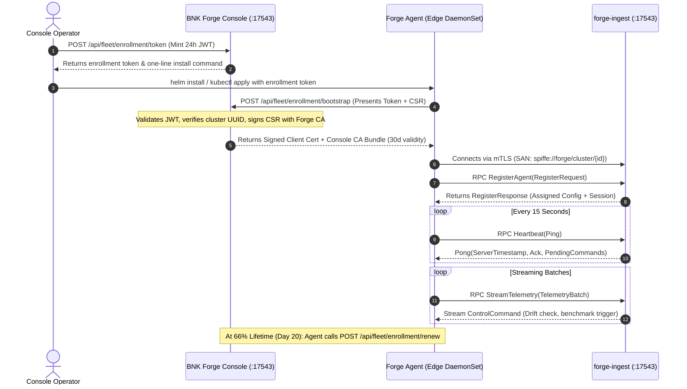

# BNK Forge Agent Protocol Specification (v1.0.0-pov)

**Document Version**: 1.0.0-pov  
**Status**: Approved for Implementation  
**Unified Port**: `:17543` (Reverse Proxy & Ingest Gateway)  
**Supported Transports**: gRPC/HTTP2 with mTLS (Primary), HTTP/WebSocket with mTLS (Fallback), NATS Leaf (Air-gap)  

---

## 1. Overview & Architecture

The **BNK Forge Agent Protocol** governs outbound telemetry ingestion, cluster registration, cryptographic identity issuance, and bidirectional control signaling between edge nodes (Kubernetes DaemonSets, bare-metal hosts, NVIDIA BlueField-3 DPUs) and the central BNK Forge platform.

### Core Protocol Tenets
1. **Outbound-Only Ingestion**: Edge agents initiate all connections outbound to the console over single port `:17543`. Zero inbound ports are opened on customer clusters.
2. **Cryptographic SPIFFE Identity**: Client authentication is enforced via mutual TLS (mTLS) with SPIFFE SAN:
   `spiffe://forge/cluster/{cluster-id}`
3. **High-Throughput Columnar Alignment**: Telemetry structures match ClickHouse analytical tables (`forge.ebpf_socket_flows`, `forge.tmm_dpdk_metrics`, `forge.ai_gateway_events`).
4. **Adaptive Batching & Flow Control**: Payloads are batched at the edge and in the ingest gateway at either **5,000 records** or **1,000ms**, with local disk spooling (`bbolt`) on WAN partitions.

---

## 2. Cryptographic Enrollment & Identity Handshake



### 2.1 Console Endpoint Self-Discovery & Addressing Resolution

When generating the agent installation command via `POST /api/fleet/enrollment/token`, the console dynamically resolves the `--set console.url` parameter based on the deployment topology:

1. **Localhost / Laptop PoV Detection**:
   * If the Web UI or API is accessed via `localhost`, `127.0.0.1`, or `0.0.0.0` (SE laptop environment), Kubernetes pods in a local cluster (Kind, Minikube, Docker Desktop) cannot dial `localhost` (which routes back to the pod itself).
   * **Self-Discovery Action**: The console auto-resolves the endpoint to:
     `https://host.docker.internal:17543` (macOS/Windows) or `https://172.17.0.1:17543` (Linux Docker bridge).
2. **Private LAN / Air-Gap Detection**:
   * If the console is accessed via an internal IP (e.g., `10.x.x.x` or `192.168.x.x`), it automatically reflects that IP on port `17543` (`https://<lan-ip>:17543`).
3. **Explicit Override & Environment Precedence**:
   * If `FORGE_CONSOLE_EXTERNAL_URL` is configured in the environment (e.g. Tailscale/mesh IP or public domain), it takes highest automated precedence.
   * Operators or automation (`bnkctl`) can pass an explicit `console_url` field in the request payload to override all automated discovery.

---

## 3. Protocol Payloads & Wire Formats

### 3.1 Protobuf Contract (`pkg/proto/forge/v1/telemetry.proto`)

```protobuf
syntax = "proto3";
package forge.v1;
option go_package = "github.com/JLCode-tech/bnk-forge/pkg/proto/forge/v1;forgev1";

enum FlowDirection {
  FLOW_DIRECTION_UNSPECIFIED = 0;
  FLOW_DIRECTION_INBOUND = 1;
  FLOW_DIRECTION_OUTBOUND = 2;
}

enum CommandType {
  COMMAND_TYPE_UNSPECIFIED = 0;
  COMMAND_TYPE_DRIFT_CHECK = 1;
  COMMAND_TYPE_BENCHMARK = 2;
  COMMAND_TYPE_CONFIG_RECONCILE = 3;
  COMMAND_TYPE_FLUSH = 4;
}

enum RegisterStatus {
  REGISTER_STATUS_UNSPECIFIED = 0;
  REGISTER_STATUS_OK = 1;
  REGISTER_STATUS_REJECTED = 2;
  REGISTER_STATUS_REQUIRE_UPGRADE = 3;
}

message EBPFSocketFlow {
  int64 timestamp = 1; // Unix microsecond timestamp
  string cluster_id = 2;
  string node_name = 3;
  uint32 net_ns_id = 4;
  string pod_name = 5;
  string namespace = 6;
  string src_ip = 7;
  uint32 src_port = 8;
  string dst_ip = 9;
  uint32 dst_port = 10;
  FlowDirection direction = 11;
  uint32 handshake_duration_us = 12;
  uint32 total_duration_ms = 13;
  uint64 bytes_sent = 14;
  uint64 bytes_received = 15;
  uint32 retransmissions = 16;
  uint32 smoothed_rtt_us = 17;
  bool tmm_bypass_violation = 18;
}

message TMMDPDKMetric {
  int64 timestamp = 1; // Unix microsecond timestamp
  string cluster_id = 2;
  string node_name = 3;
  string tmm_pod = 4;
  uint32 core_id = 5;
  string interface = 6;
  uint64 rx_packets = 7;
  uint64 rx_bytes = 8;
  uint64 rx_drops = 9;
  uint64 tx_packets = 10;
  uint64 tx_bytes = 11;
  uint64 tx_drops = 12;
  float rx_ring_descriptor_occupancy = 13;
  float tx_ring_descriptor_occupancy = 14;
  float cpu_utilization_pct = 15;
  uint64 hugepage_used_bytes = 16;
}

message AIGatewayEvent {
  int64 timestamp = 1; // Unix millisecond timestamp
  string cluster_id = 2;
  string client_id = 3;
  string model_name = 4;
  string route_name = 5;
  uint32 prompt_tokens = 6;
  uint32 completion_tokens = 7;
  uint32 time_to_first_token_ms = 8;
  uint32 total_latency_ms = 9;
  uint32 status_code = 10;
  double cost_usd = 11;
}

message TelemetryBatch {
  string batch_id = 1;
  string cluster_id = 2;
  string node_name = 3;
  int64 sent_at = 4;
  repeated EBPFSocketFlow flows = 5;
  repeated TMMDPDKMetric metrics = 6;
  repeated AIGatewayEvent ai_events = 7;
  map<string, string> metadata = 8;
}

message ControlCommand {
  string command_id = 1;
  CommandType type = 2;
  string payload = 3;
  int64 created_at = 4;
}

message RegisterRequest {
  string cluster_id = 1;
  string cluster_name = 2;
  string agent_version = 3;
  string hostname = 4;
  string node_name = 5;
  repeated string capabilities = 6;
  string machine_fingerprint = 7;
  map<string, string> labels = 8;
}

message RegisterResponse {
  RegisterStatus status = 1;
  string agent_id = 2;
  string session_token = 3;
  int64 server_time = 4;
  uint32 heartbeat_interval_sec = 5;
  map<string, string> assigned_config = 6;
  string message = 7;
}

message Ping {
  string cluster_id = 1;
  string agent_id = 2;
  int64 timestamp = 3;
  string status = 4;
  uint64 uptime_seconds = 5;
}

message Pong {
  int64 server_timestamp = 1;
  bool ack = 2;
  uint32 pending_commands_count = 3;
}

service TelemetryService {
  rpc StreamTelemetry(stream TelemetryBatch) returns (stream ControlCommand);
  rpc RegisterAgent(RegisterRequest) returns (RegisterResponse);
  rpc Heartbeat(Ping) returns (Pong);
}
```

---

## 4. HTTP / WebSocket Fallback Protocol (`:17543`)

For corporate environments intercepting gRPC HTTP/2 framing, the protocol supports an HTTP REST and WebSocket fallback:

1. **Bootstrap**: `POST /api/fleet/enrollment/bootstrap`
   - Headers: `Authorization: Bearer <enrollment_jwt>`
   - Body: `{"csr": "<PEM_CSR>", "cluster_id": "<UUID>", "hostname": "<NAME>"}`
   - Response: `{"certificate": "<PEM_CERT>", "ca_certificate": "<PEM_CA>", "expires_at": "<ISO8601>"}`

2. **WebSocket Telemetry Stream**: `WSS /ws/fleet/telemetry`
   - Query: `?cluster_id=<UUID>&agent_id=<ID>`
   - Headers: Client mTLS certificate presentation
   - Frame Format: JSON or Binary Protobuf encoded `TelemetryBatch`
   - Inbound downlinks: JSON `ControlCommand`

3. **HTTP Heartbeat**: `POST /api/fleet/heartbeat`
   - Body: JSON `Ping`
   - Response: JSON `Pong`

---

## 5. Failure Recovery & Local Buffering

- **Network Partitions**: The agent maintains an embedded Write-Ahead Log (`bbolt`) at `/var/lib/forge-agent/spool.db` (500MB maximum size).
- **Backpressure**: When the local spool reaches 80% capacity, eBPF sampling dynamically downsamples high-frequency health probes while preserving connection drop and latency anomaly events.
- **Replay**: Upon reconnection, spooled events are drained chronologically with an adaptive rate limiter preventing ingest storms.
