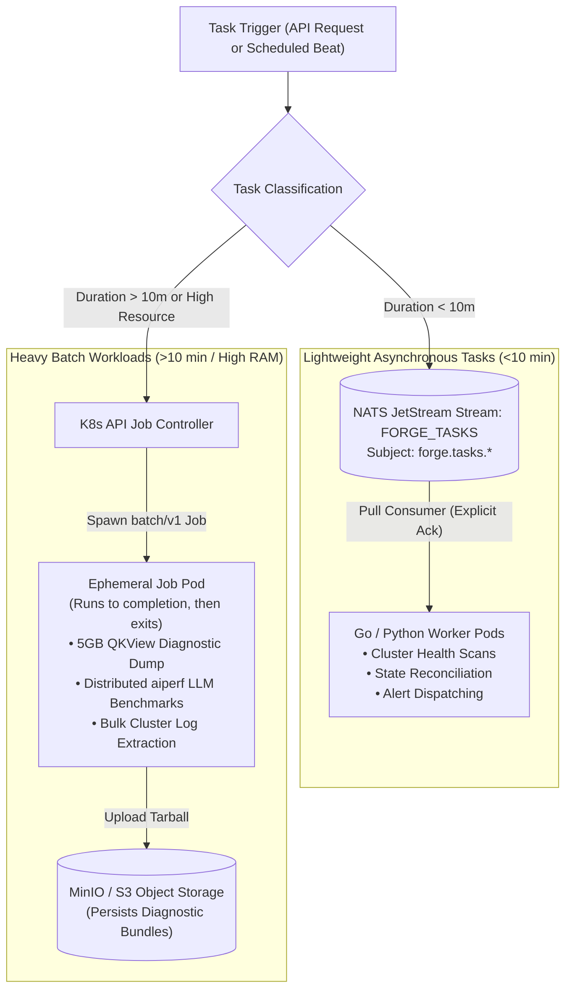

# BNK Forge Data Platform & Task Orchestration Specification
**Document Version:** 1.0.0-pov  
**Status:** Approved for Implementation  
**Target Environments:** Self-Hosted Enterprise (Air-Gapped / Connected) & Managed SaaS  
**Core Technologies:** ClickHouse, PostgreSQL 16 (Atlas Managed), NATS JetStream, Kubernetes Jobs  

---

## 1. Architectural Overview & Decommissioning Celery/Redis

In the legacy PoC architecture (v4.3.3), data persistence and background task processing were tightly coupled to PostgreSQL 16, Redis 7, Celery Workers, and Celery Beat. This stack suffered from severe operational issues:
* **Relational Overload:** High-frequency telemetry (TMM metrics, pod status deltas) was forced into relational PostgreSQL tables, causing WAL bloat and locking contention.
* **Celery/Redis Fragility:** Celery workers running on host networking mounting AWS credentials frequently hung during long-running tasks (such as 5GB QKView diagnostic collections or distributed `aiperf` benchmark runs), blocking lighter health checks.
* **Dual Persistence Layer:** Redis was used simultaneously as a Celery broker, an ephemeral results backend, and a short-lived API cache (60s–120s TTLs), introducing cache invalidation bugs and memory leaks.

```mermaid
flowchart TD
    subgraph DataSinks["Modernized Storage & Messaging Platform"]
        ClickHouseDB[("ClickHouse Cluster\n• Time-Series Telemetry\n• Raw eBPF Socket Flows\n• TMM DPDK Ring Counters\n• AI Gateway Token Metrics")]
        PostgresDB[("PostgreSQL 16 (Atlas Managed)\n• Cluster & Node Inventories\n• Tenant & User RBAC\n• Declarative Blueprints\n• Audit Logging")]
        NATSJetStream["NATS JetStream Engine\n• Edge-to-Core Ingest Bus\n• Durable WorkQueues\n• Real-Time State Delta Pub/Sub")]
    end

    subgraph IngestAndAPI["Control Plane Services"]
        IngestGW["forge-ingest Gateway (:17543 Go)\n• Hot-path bulk insert into ClickHouse\n• Publishes cluster state to NATS"]
        FastAPIServer["FastAPI Control Plane (:443)\n• Cold-path REST APIs & UI\n• Reads Postgres state\n• Queries analytical metrics from ClickHouse"]
        K8sJobLauncher["K8s Job Controller\n• Spawns Ephemeral Batch Jobs"]
    end

    IngestGW -- "Batch Bulk Insert (Native TCP)" --> ClickHouseDB
    IngestGW -- "Publish State Deltas" --> NATSJetStream

    NATSJetStream -- "Consume WorkQueue Tasks" --> FastAPIServer
    FastAPIServer <--> PostgresDB
    FastAPIServer -- "Analytical Queries" --> ClickHouseDB
    FastAPIServer --> K8sJobLauncher
```

### Core Platform Pillars
1. **ClickHouse Cluster:** Dedicated analytical store for high-volume time-series metrics, raw eBPF connection flows, TMM DPDK counters, and LLM AI Gateway logs.
2. **PostgreSQL 16 (Atlas Governed):** The single transactional database for application state, multi-tenant RBAC, and declarative blueprints, managed entirely via Atlas declarative schemas (`schema.hcl`).
3. **NATS JetStream:** A single, cloud-native streaming engine replacing Redis and Celery. Serves simultaneously as the edge ingest bus and durable asynchronous task queue.
4. **Ephemeral Kubernetes Jobs:** Completely replaces dedicated Celery worker pools for resource-intensive, long-running tasks.

---

## 2. ClickHouse Analytical Engine

ClickHouse serves as the hot telemetry sink, capable of ingesting hundreds of thousands of events per second with 10x columnar compression.

### 2.1 Core Telemetry Schemas

#### A. eBPF Socket Flows (`ebpf_socket_flows`)
Stores granular TCP connection lifecycles, latency, and retransmissions captured by the agent:

```sql
CREATE TABLE IF NOT EXISTS forge.ebpf_socket_flows (
    timestamp DateTime64(3, 'UTC') CODEC(DoubleDelta, LZ4),
    cluster_id UUID CODEC(ZSTD),
    node_name LowCardinality(String) CODEC(ZSTD),
    net_ns_id UInt32 CODEC(T64, LZ4),
    pod_name LowCardinality(String) CODEC(ZSTD),
    namespace LowCardinality(String) CODEC(ZSTD),
    src_ip IPv6 CODEC(ZSTD),
    src_port UInt16 CODEC(T64, LZ4),
    dst_ip IPv6 CODEC(ZSTD),
    dst_port UInt16 CODEC(T64, LZ4),
    direction Enum8('INBOUND' = 1, 'OUTBOUND' = 2),
    handshake_duration_us UInt32 CODEC(T64, LZ4),
    total_duration_ms UInt32 CODEC(T64, LZ4),
    bytes_sent UInt64 CODEC(T64, LZ4),
    bytes_received UInt64 CODEC(T64, LZ4),
    retransmissions UInt32 CODEC(T64, LZ4),
    smoothed_rtt_us UInt32 CODEC(T64, LZ4),
    tmm_bypass_violation UInt8 CODEC(T64, LZ4)
) ENGINE = MergeTree()
PARTITION BY toYYYYMM(timestamp)
ORDER BY (cluster_id, namespace, pod_name, dst_port, timestamp)
TTL timestamp + INTERVAL 30 DAY;
```

#### B. TMM DPDK Microkernel Counters (`tmm_dpdk_metrics`)
Stores low-level DPDK ring buffer performance scraped from F5 BNK TMM pods:

```sql
CREATE TABLE IF NOT EXISTS forge.tmm_dpdk_metrics (
    timestamp DateTime64(3, 'UTC') CODEC(DoubleDelta, LZ4),
    cluster_id UUID CODEC(ZSTD),
    node_name LowCardinality(String) CODEC(ZSTD),
    tmm_pod LowCardinality(String) CODEC(ZSTD),
    core_id UInt16 CODEC(T64, LZ4),
    interface LowCardinality(String) CODEC(ZSTD),
    rx_packets UInt64 CODEC(T64, LZ4),
    rx_bytes UInt64 CODEC(T64, LZ4),
    rx_drops UInt64 CODEC(T64, LZ4),
    tx_packets UInt64 CODEC(T64, LZ4),
    tx_bytes UInt64 CODEC(T64, LZ4),
    tx_drops UInt64 CODEC(T64, LZ4),
    rx_ring_descriptor_occupancy Float32 CODEC(Gorilla, LZ4),
    tx_ring_descriptor_occupancy Float32 CODEC(Gorilla, LZ4),
    cpu_utilization_pct Float32 CODEC(Gorilla, LZ4),
    hugepage_used_bytes UInt64 CODEC(T64, LZ4)
) ENGINE = MergeTree()
PARTITION BY toYYYYMM(timestamp)
ORDER BY (cluster_id, tmm_pod, interface, core_id, timestamp)
TTL timestamp + INTERVAL 14 DAY;
```

#### C. AI Gateway Observability & Token Metrics (`ai_gateway_events`)
Correlates F5 AI Gateway prompts, completion tokens, latency, and model metrics:

```sql
CREATE TABLE IF NOT EXISTS forge.ai_gateway_events (
    timestamp DateTime64(3, 'UTC') CODEC(DoubleDelta, LZ4),
    cluster_id UUID CODEC(ZSTD),
    client_id LowCardinality(String) CODEC(ZSTD),
    model_name LowCardinality(String) CODEC(ZSTD),
    route_name LowCardinality(String) CODEC(ZSTD),
    prompt_tokens UInt32 CODEC(T64, LZ4),
    completion_tokens UInt32 CODEC(T64, LZ4),
    time_to_first_token_ms UInt32 CODEC(T64, LZ4),
    total_latency_ms UInt32 CODEC(T64, LZ4),
    status_code UInt16 CODEC(T64, LZ4),
    cost_usd Float64 CODEC(Gorilla, LZ4)
) ENGINE = MergeTree()
PARTITION BY toYYYYMM(timestamp)
ORDER BY (cluster_id, model_name, client_id, timestamp)
TTL timestamp + INTERVAL 90 DAY;
```

### 2.2 Materialized Views for Dashboard Performance
To ensure UI dashboard queries return in <50ms, ClickHouse maintains 1-minute rollup aggregations automatically:

```sql
CREATE MATERIALIZED VIEW IF NOT EXISTS forge.mv_pod_traffic_1m
ENGINE = SummingMergeTree()
PRIMARY KEY (cluster_id, namespace, pod_name, window_start)
AS SELECT
    toStartOfMinute(timestamp) AS window_start,
    cluster_id,
    namespace,
    pod_name,
    count() AS total_connections,
    sum(bytes_sent) AS total_bytes_sent,
    sum(bytes_received) AS total_bytes_received,
    sum(retransmissions) AS total_retransmits,
    avg(smoothed_rtt_us) AS avg_rtt_us
FROM forge.ebpf_socket_flows
GROUP BY window_start, cluster_id, namespace, pod_name;
```

---

## 3. Cloud-Native Task Orchestration (Celery Replacement)

The Celery/Redis worker daemon is retired in favor of a dual-engine orchestration pattern: **NATS JetStream WorkQueues** for lightweight asynchronous tasks, and **Ephemeral Kubernetes Jobs** for heavy batch workloads.



### 3.1 NATS JetStream WorkQueues (Standard Tasks)
* **Stream Definition:** A durable stream named `FORGE_TASKS` configured with `Retention: WorkQueue`. Once a task is acknowledged by a worker, it is safely removed from the queue.
* **Consumer Semantics:** Workers pull tasks in batches using explicit acknowledgments (`msg.Ack()`). If a worker crashes mid-task, JetStream detects the missing heartbeat and redelivers the message to an available worker.
* **Dead Letter Queue (DLQ):** Messages exceeding `MaxDeliver: 3` are automatically routed to `FORGE_TASKS_DLQ` for administrator inspection.

### 3.2 Ephemeral Kubernetes Jobs (Heavy Batch Workloads)
* **The Problem with Worker Pools:** Generating an F5 QKView diagnostic bundle or running an `aiperf` benchmark requires significant memory (often 4GB–8GB RAM) and CPU burst. In a fixed Celery worker pool, one QKView task can cause an Out-Of-Memory (OOM) kill that crashes unrelated background tasks.
* **The Kubernetes Job Pattern:**
  1. FastAPI issues a call to the local Kubernetes API:
     ```python
     job = k8s_batch_client.create_namespaced_job(
         namespace="forge-system",
         body=generate_qkview_job_spec(cluster_id, bundle_id)
     )
     ```
  2. The Kubernetes scheduler places the job on an available node with appropriate resource limits:
     ```yaml
     apiVersion: batch/v1
     kind: Job
     metadata:
       name: forge-qkview-cls-9481a-1731765000
       namespace: forge-system
     spec:
       ttlSecondsAfterFinished: 3600
       backoffLimit: 1
       template:
         spec:
           restartPolicy: Never
           containers:
             - name: qkview-collector
               image: registry.internal/forge/qkview-collector:v1.1.0
               resources:
                 limits:
                   memory: "6Gi"
                   cpu: "2"
               env:
                 - name: TARGET_CLUSTER_ID
                   value: "cls-9481a"
                 - name: S3_UPLOAD_BUCKET
                   value: "forge-diagnostics"
     ```
  3. The pod executes to completion, uploads the 5GB diagnostic tarball to MinIO/S3, publishes a completion event to NATS JetStream, and terminates.
  4. Kubernetes cleans up the finished pod automatically via `ttlSecondsAfterFinished`. Zero worker memory leaks, zero worker daemon starvation.

---

## 4. Ingest Gateway Hot-Path Pipeline

The **Ingest Gateway** (`cmd/forge-ingest`) is a high-throughput Go daemon listening on `:17543` designed to bridge edge agents to ClickHouse and NATS with maximum efficiency.

### 4.1 Ingestion Pipeline Mechanics
1. **mTLS Termination:** Terminates incoming TLS 1.3 streams, extracting the agent's SPIFFE ID (`spiffe://forge/cluster/{cluster-id}`).
2. **Zero-Allocation Batching:** Reads incoming protobuf batches into a circular ring buffer in memory.
3. **Bulk Insertion:**
   * Batches telemetry until **5,000 rows** or **1,000ms** elapsed.
   * Flushes records directly to ClickHouse using the native high-performance ClickHouse TCP client (`github.com/ClickHouse/clickhouse-go/v2`).
4. **State Delta Publishing:**
   * Extracts cluster state events (pod creation/deletion, TMM interface status changes, drift violations) and publishes them to NATS subject:
     `forge.cluster.{cluster-id}.events`
   * FastAPI consumers subscribe to this subject to update real-time UI dashboards via WebSockets.

---

## 5. Storage Sizing & Sizing Guidelines for PoV Deployments

| Component | Minimum PoV (1–10 Clusters) | Production Enterprise (10–100 Clusters) | Sovereign AI / Cloud Scale (100+ Clusters) |
| :--- | :--- | :--- | :--- |
| **PostgreSQL 16** | 2 vCPU, 4GB RAM, 50GB SSD | 4 vCPU, 8GB RAM, 200GB SSD | 8 vCPU, 16GB RAM, 500GB SSD (Managed HA) |
| **ClickHouse** | 4 vCPU, 8GB RAM, 250GB SSD | 8 vCPU, 16GB RAM, 1TB NVMe | 3-Node Cluster: 16 vCPU, 32GB RAM each |
| **NATS JetStream** | 1 vCPU, 2GB RAM, 20GB SSD | 3-Node Cluster: 2 vCPU, 4GB RAM each | 3-Node Cluster: 4 vCPU, 8GB RAM each |
| **Ingest Gateway** | 1 vCPU, 512MB RAM | 2 vCPU, 1GB RAM | 4 vCPU, 2GB RAM (Horizontal Auto-Scaling) |
| **FastAPI Console** | 2 vCPU, 2GB RAM | 4 vCPU, 4GB RAM (2 Replicas) | 8 vCPU, 8GB RAM (4 Replicas) |
