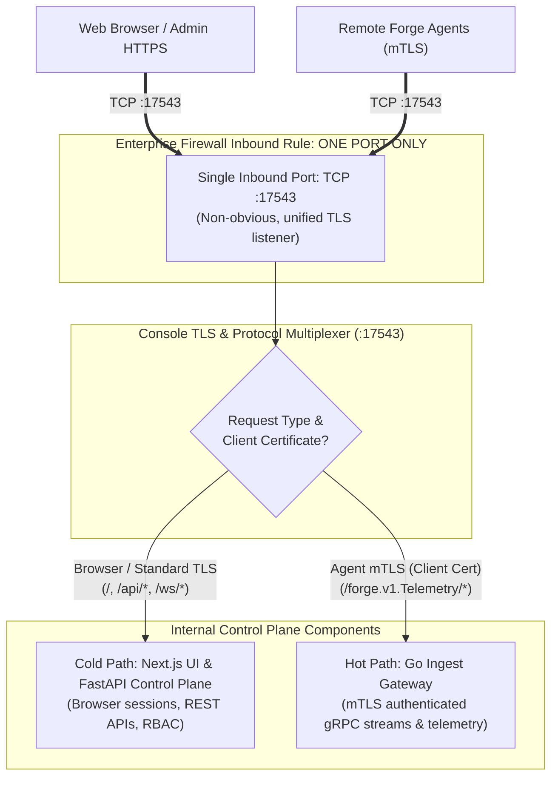
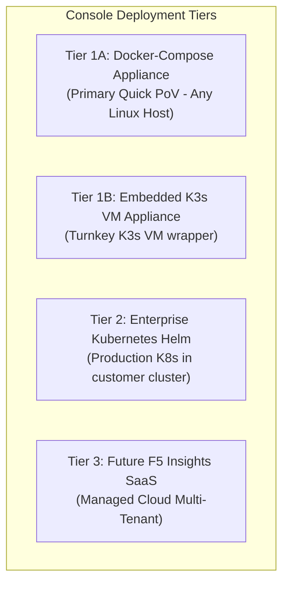
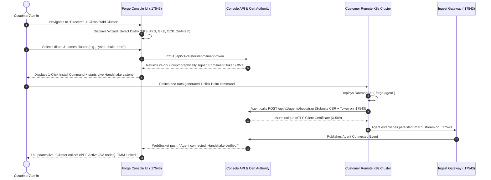

# BNK Forge Deployment Models, Customer Prerequisites & Console-Driven Enrollment
**Document Version:** 1.1.0-pov  
**Status:** Approved for Implementation  
**Target Audience:** Enterprise Customers (Viettel, Yotta, NPCI), Sales Engineers, Infrastructure Architects  

---

## 1. Overview & Single-Port Architecture

To make deployment seamless for customer Proof of Value (PoV) engagements, BNK Forge adopts a **Single Unified Port Architecture** on a non-obvious port: **TCP `:17543`**.

Instead of requiring enterprise network teams to approve multiple firewall rules (e.g. separate ports for UI, REST APIs, and agent streams), the Forge Console terminates **both** the interactive Web UI/REST API and high-speed agent mTLS gRPC streams over the **exact same single port `:17543`**.



### How Single-Port Multiplexing Works:
1. **Unified Listener:** The console gateway listens on `0.0.0.0:17543` with TLS 1.3.
2. **Optional Client Auth (`VerifyClientCertIfGiven`):**
   * If a **remote Forge Agent** connects, it presents its x509 client certificate issued during bootstrap. The gateway verifies the SPIFFE ID (`spiffe://forge/cluster/{id}`) and routes the gRPC bidi-stream directly to the high-throughput Go Ingest engine.
   * If an **administrator browser** connects, no client certificate is presented. The gateway negotiates standard HTTPS and routes HTTP/1.1 and HTTP/2 traffic to the Next.js UI and FastAPI control plane.
3. **Firewall Impact:** The customer SecOps team opens **exactly one single port**: `TCP :17543`.

---

## 2. Console Hosting Tiers: What the Customer Provides



### Detailed Requirements by Tier

| Requirement | Tier 1A: Docker PoV *(Primary)* | Tier 1B: K3s VM Appliance *(Turnkey)* | Tier 2: Enterprise K8s *(Prod)* | Tier 3: Future F5 Insights *(SaaS)* |
| :--- | :--- | :--- | :--- | :--- |
| **Target Runtime** | Docker Engine 24+ & Docker Compose v2 | Single Linux VM (Ubuntu 22.04 / RHEL 9) | K8s 1.25+ (EKS, AKS, GKE, OCP) | Managed Cloud (F5 Hosted) |
| **Compute / CPU** | 4–8 vCPU | 8 vCPU | 8 vCPU request pool | Zero infrastructure provided |
| **Memory (RAM)** | 16GB RAM | 16GB–32GB RAM | 16GB–32GB RAM | Zero infrastructure provided |
| **Storage (Disk)** | 100GB–250GB fast SSD | 150GB–250GB SSD | PersistentVolumes (SSD) | Zero infrastructure provided |
| **Inbound Ports** | **Single Port: TCP `:17543`** | **Single Port: TCP `:17543`** | **Single Port: TCP `:17543`** | Standard HTTPS to SaaS URL |
| **Outbound Access** | Air-gap allowed | Air-gap allowed | Air-gap allowed | Internet access to F5 SaaS |
| **Status** | **Available Now (PoV)** | **Available Now (PoV)** | **Milestone 6** | **Future Roadmap** |

---

## 3. Detailed Console Deployment Models

### Tier 1A: Docker-Based PoV Appliance (Primary for Quick Customer PoVs)
This is the fastest, lowest-friction deployment model for 15-minute qualification calls and proof-of-value trials. It requires only standard Docker and Docker Compose on an existing Linux host.

#### Installation:
```bash
# 1. Download or transfer PoV package:
tar -xzf forge-v1.1.0-docker-pov.tar.gz && cd forge-docker-pov

# 2. Start all services:
docker compose up -d

# 3. Access console:
https://<host-ip>:17543
```
* **Internal Services:** Runs `forge-console` (FastAPI + Next.js), `forge-ingest` (Go Gateway), `clickhouse`, `postgres16` (Atlas managed), and `nats` (JetStream enabled).
* **Port Mapping:** Exposes only `:17543` on the host.

---

### Tier 1B: Embedded K3s VM Appliance (Turnkey Virtual Appliance)
For customers requiring an appliance feel where everything runs under Kubernetes primitives without them managing a cluster. A turnkey VM with an embedded, self-contained K3s wrapper.

#### Installation:
```bash
# Run the turnkey appliance bootstrapper on a fresh VM:
curl -fsSL https://get.forge.f5.com/install-k3s-appliance.sh | sudo bash

# Or in an air-gapped environment:
sudo ./install-k3s-appliance.sh --offline --bundle forge-k3s-airgap.tar.gz
```
* **How it works:** Installs a lightweight single-node K3s instance isolated to `/opt/forge/k3s`, applies local Helm charts, and provisions local SSD storage.
* **Management:** Zero K8s maintenance required by the customer; systemd manages the entire K3s wrapper service.
* **Network:** Binds directly to host interface on port `:17543`.

---

### Tier 2: Self-Hosted Enterprise Kubernetes (Helm)
For customers who mandate that Forge run inside their corporate Kubernetes cluster (e.g. OpenShift, EKS, on-prem RKE2).

#### Installation:
```bash
helm repo add bnk-forge https://charts.forge.f5.com
helm install forge-console bnk-forge/forge-console \
  --namespace forge-system --create-namespace \
  --set service.port=17543 \
  --set clickhouse.persistence.size="250Gi" \
  --set postgresql.persistence.size="50Gi"
```

---

### Tier 3: Future F5 Insights SaaS (Future Roadmap)
Long-term evolution into a fully managed multi-tenant cloud control plane under the **F5 Insights** family.
* Customers provide zero infrastructure.
* Organizations register online and immediately generate cluster enrollment commands pointing to `https://insights.f5.com:17543`.

---

## 4. What the Customer Provides for Target Clusters (Agent Side)

For each cluster or edge node running F5 BNK:

| Dimension | Specification | Notes |
| :--- | :--- | :--- |
| **Kubernetes Version** | K8s 1.24 through 1.31+ | Supported across EKS, AKS, GKE, OpenShift, on-prem. |
| **Linux Kernel** | Kernel **4.18+** (RHEL 8 / OpenShift 4.10+) or **5.4+** (Ubuntu / cloud) | Modern kernels use zero-copy RingBuffer; 4.18 uses PerfBuffer fallback. |
| **Agent Footprint** | **0.2 vCPU, 50MB RAM** per node | Negligible overhead on customer workloads. |
| **Cluster RBAC** | Scoped `ClusterRole` and `ServiceAccount` | Read-only access to nodes, pods, services, and F5 CRDs. |
| **Host Volume Access** | Read-only mount of `/var/run/tmm/` | Required for the TMM DPDK Harvester to read `tmctl.sock`. |
| **Outbound Firewall** | **Outbound TCP `:17543` only** to Forge Console | **Zero inbound ports.** Outbound mTLS only. Traverses corporate forward proxies. |

---

## 5. Console-Driven Agent Enrollment Workflow

The agent installation experience is entirely driven **from within the Forge Console UI**. Administrators never have to manually craft YAML manifests or decipher command-line flags.



### 5.1 The "Add Cluster" UI Wizard Options

When the administrator opens the **"Add Cluster"** wizard, the console provides tailored, copy-pasteable installation options:

#### Option A: Helm 1-Click (Recommended for K8s)
```bash
helm repo add bnk-forge https://charts.forge.f5.com
helm upgrade --install forge-agent bnk-forge/forge-agent \
  --namespace forge-agent-system --create-namespace \
  --set console.endpoint="forge.customer.internal:17543" \
  --set enrollment.token="eyJhbGciOiJFRDI1NTE5..." \
  --set cluster.name="yotta-shakti-prod"
```

#### Option B: `kubectl` 1-Liner (Zero Helm Requirement)
```bash
curl -sSL "https://forge.customer.internal:17543/api/v1/enroll/bootstrap.yaml?token=eyJhbGciOi..." | kubectl apply -f -
```

#### Option C: Host Script (Bare Metal / NVIDIA BlueField-3 DPU)
```bash
curl -sSL "https://forge.customer.internal:17543/api/v1/enroll/install-agent.sh" | sudo bash -s -- \
  --console="forge.customer.internal:17543" \
  --token="eyJhbGciOiJFRDI1NTE5..."
```

---

### 5.2 Real-Time Handshake Feedback in Console UI

While the admin runs the command, the UI modal transitions from a spinner to a real-time progress checklist:

* [x] **Cluster Registered:** `yotta-shakti-prod` assigned UUID `cls-9481a8b2`.
* [x] **mTLS Handshake:** Agent connected from `10.244.3.15` (Cert issued with SAN `spiffe://forge/cluster/cls-9481a8b2` on port `:17543`).
* [x] **eBPF Socket Observer:** Loaded on 3 of 3 nodes (Kernel 5.15, zero CNI collisions with Calico).
* [x] **TMM DPDK Harvester:** Successfully linked to 2 F5 BNK TMM pods via `/var/run/tmm/tmctl.sock`.
* [x] **Telemetry Stream Active:** 1,240 socket flows/sec streaming into ClickHouse.

The modal automatically closes and redirects the user to the live **Cluster Topology & TMM Telemetry Dashboard**.
