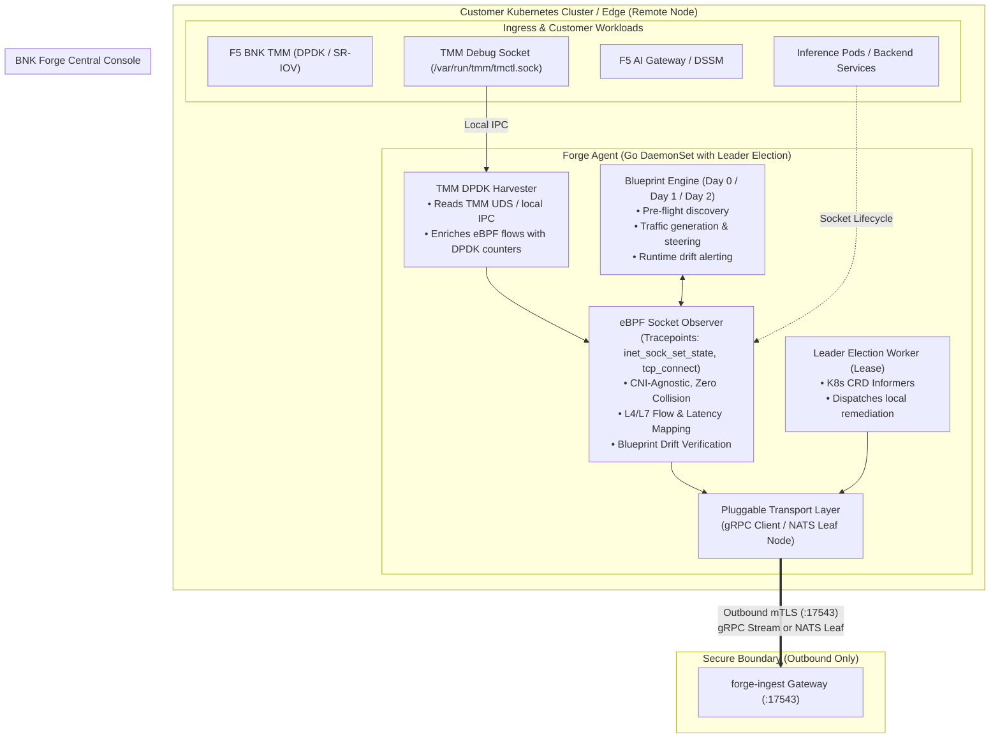
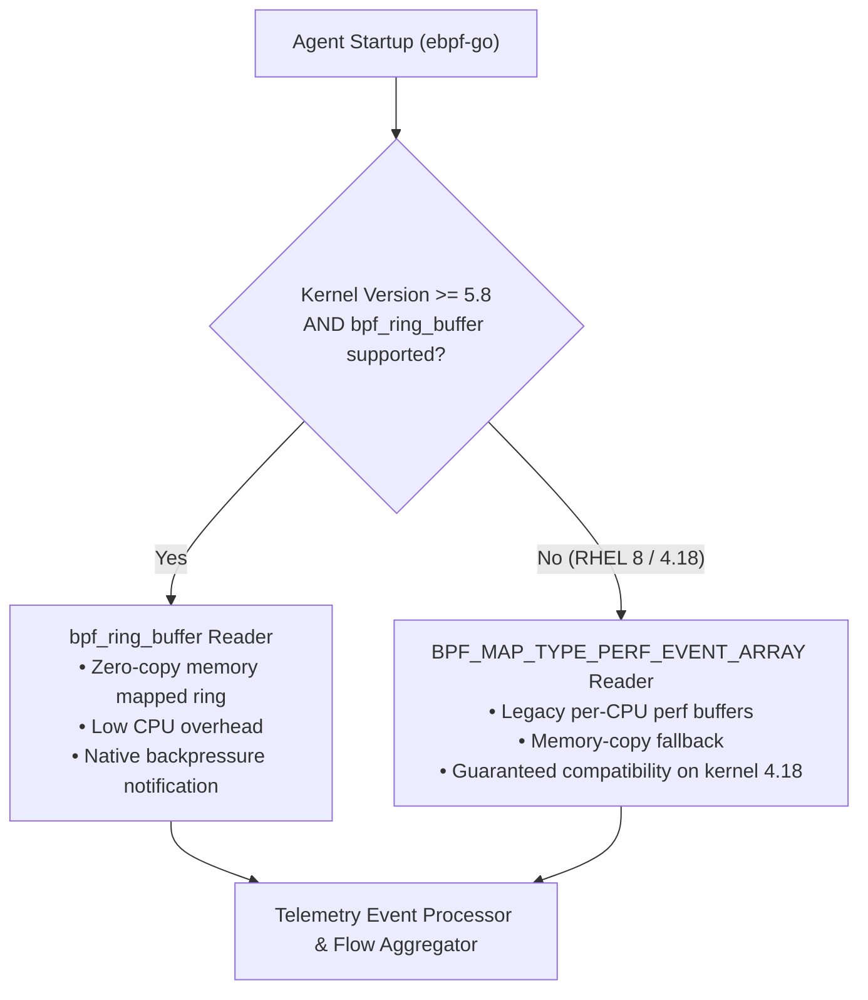
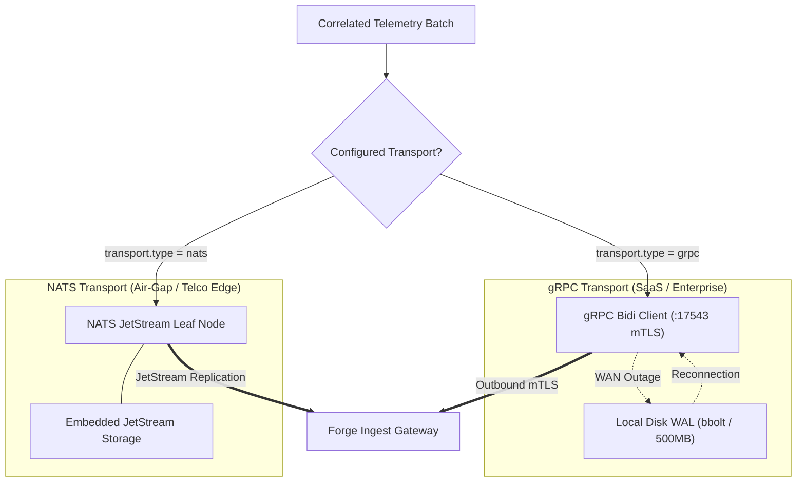

# BNK Forge Agent Architecture & Edge Specification
**Document Version:** 1.0.0-pov  
**Status:** Approved for Implementation  
**Target Environments:** Kubernetes (EKS, AKS, GKE, OpenShift, On-Prem) & Linux Host / DPU (NVIDIA BlueField-3)  
**Implementation Language:** Go 1.23+ (`cilium/ebpf` / `ebpf-go`, `client-go`)  

---

## 1. Overview & Edge Operational Model

The **Forge Agent** (`forge-agent`) is an ultra-lightweight, high-performance edge daemon designed to run directly inside customer Kubernetes clusters, edge nodes, and BlueField-3 DPUs. It replaces the legacy pull-based architecture (where a central console decrypted `kubeconfig` files and polled remote clusters over the WAN) with an **outbound-only, push-based model**.



### Core Design Principles
1. **Outbound-Only Connectivity:** The agent initiates all communication outbound over the single unified port `:17543` using mutual TLS (mTLS). Zero inbound firewall ports (`:6443`, `:22`) are exposed on customer infrastructure.
2. **eBPF-First Observer:** Universal, CNI-agnostic kernel socket tracepoints map network topology, connection handshakes, round-trip times (RTT), and blueprint conformance across all pods without requiring sidecar injection.
3. **DPDK Kernel-Bypass Enrichment:** Because F5 Big-IP Next (BNK) TMM operates via DPDK/SR-IOV (bypassing the Linux network stack), the agent pairs eBPF with an in-node **TMM Harvester** that extracts microkernel counters, ring buffer occupancy, and packet drops, merging them directly into the eBPF flow graph.
4. **Decoupled from `bnkctl` Provisioning:** `bnkctl` remains an external infrastructure CLI. The agent does not embed heavy cloud SDKs, keeping its binary size under 35MB and RSS memory under 40MB.
5. **Pluggable Dual Transport:** Supports both standard **gRPC over mTLS** (for corporate proxies and SaaS) and **NATS JetStream Leaf Nodes** (for air-gapped telco and sovereign clouds).

---

## 2. The eBPF Engine: CNI-Agnostic, Non-Interfering Observation

To ensure universal compatibility across diverse customer environments (AWS VPC CNI, Azure CNI, Calico, Flannel, Cilium, and OpenShift OVN-Kubernetes), the agent avoids hooks that modify network device queues or conflict with existing CNI plugins.

### 2.1 Hook Selection & Conflict Elimination

| Hook Mechanism | Evaluated? | CNI Collision Risk | DPDK Compatibility | Architectural Decision |
| :--- | :--- | :--- | :--- | :--- |
| **Traffic Control (`tc` / `clsact`)** | Yes | **EXTREME** (Clobbers root qdiscs on Calico, Cilium, AWS VPC CNI) | Incompatible (DPDK bypasses netdev) | **REJECTED.** Never attach to `tc`. |
| **eXpress Data Path (`XDP`)** | Yes | **HIGH** (Most NIC drivers allow only 1 XDP program; conflicts with cloud driver) | Incompatible (DPDK detaches kernel driver) | **REJECTED.** Never attach to XDP. |
| **cgroup v2 (`sockops`)** | Evaluated | Low | Incompatible | **Restricted.** Fragile across cgroup v1/v2 hybrid environments (RHEL 8 / Docker). |
| **Socket Tracepoints (`tracepoint/sock/*`)** | **Selected** | **ZERO** (Static, multi-subscriber kernel taps) | Traces socket endpoints connecting to TMM | **PRIMARY HOOK.** 100% CNI-agnostic and kernel ABI-stable. |
| **Socket Kprobes (`kprobe/tcp_connect`)** | **Selected** | **ZERO** (Kernel dynamic tap, safe multi-tool attach) | Universal across Linux 3.10+ | **PRIMARY HOOK.** Captures latency, initiation, and error returns. |

### 2.2 Standardized Socket-Layer Hooks

The agent attaches exclusively at the Linux socket layer:

1. **`tracepoint:sock:inet_sock_set_state`:**
   * **Universal Portability:** Integrated into upstream Linux 4.15+. Supported on RHEL 8 (4.18), Ubuntu 20.04+, and all modern kernels.
   * **Flow Tracking:** Fires on every TCP state machine change (`TCP_SYN_SENT` $\rightarrow$ `TCP_ESTABLISHED` $\rightarrow$ `TCP_CLOSE`).
   * **Extracted Metadata:** Source IP:Port, Destination IP:Port, socket cookie, Network Namespace ID (`net_ns`), and exact handshake latency.
2. **`kprobe:tcp_v4_connect` & `kretprobe:tcp_v4_connect`:**
   * Captures outbound connection initiation and return status across all containers on the host.
3. **`tracepoint:tcp:tcp_destroy_sock`:**
   * Fires upon socket termination. Extracts total connection duration, bytes transmitted, bytes received, packet retransmissions (congestion/drop indicator), and smoothed round-trip time (`srtt_us`).

### 2.3 Kernel Spectrum & Dual Event Buffer Architecture

Customer Kubernetes nodes span a wide spectrum of Linux kernel versions:
* **Modern Cloud Kernels (5.8+):** EKS AL2023 (6.1), AKS Azure Linux (5.15/6.6), GKE COS (5.15/6.1), OpenShift 4.14+ (5.14).
* **Legacy Enterprise Kernels (4.18 / 5.4):** OpenShift 4.10–4.13 (RHEL 8.4/8.6, kernel 4.18), AWS EKS AL2 (5.4), Ubuntu 20.04 LTS (5.4).

To guarantee zero crashes without requiring host-side compilation:



* **CO-RE & BTF:** The agent embeds pre-compiled CO-RE bytecode. For legacy kernels lacking `/sys/kernel/btf/vmlinux`, the agent embeds compressed BTFHub slices for common enterprise distributions.

---

## 3. TMM DPDK Enrichment Harvester

### 3.1 The DPDK Blind Spot
F5 Big-IP Next (BNK) TMM binds dedicated network interfaces using DPDK (`vfio-pci` or `uio_pci_generic`). Inference traffic passing through BNK never creates a Linux `sk_buff` or enters the host TCP/IP stack. Consequently, pure eBPF sensors observe total silence on DPDK links.

### 3.2 Harvester Mechanics
To provide end-to-end visibility, the Forge Agent implements an in-node **TMM Harvester**:
1. **Local Socket Access:** Mounts `/var/run/tmm/` from the host, connecting directly to the TMM debug Unix Domain Socket (`tmctl.sock`) or running lightweight IPC against the debug sidecar.
2. **Real-Time Extraction:** Scrapes internal hardware and software metrics at 5-second intervals:
   * **Interface & Ring Telemetry:** Hardware RX/TX drops, ring descriptor exhaustion, and buffer overruns per queue.
   * **TMM Microkernel Health:** CPU cycles per core, worker thread saturation, and hugepage memory allocation.
   * **Traffic Profiling:** Active HTTP/2 and gRPC streams, AI token throughput, and client/server connection pools.
3. **Flow Graph Enrichment:** The agent matches the client/backend IP addresses observed by the eBPF socket tracer with TMM's internal connection tables, injecting DPDK ring metrics and drop counters directly into the flow records before transmission.

---

## 4. Day 0, Day 1, and Day 2 Blueprints

The agent acts as the local orchestrator and verifier of declarative **Cluster Blueprints**:

```mermaid
flowchart LR
    subgraph Day0["Day 0: Discovery & Pre-Flight"]
        D0_1["Kernel & BTF Capability Probe"]
        D0_2["Detect DPDK & CNI Type"]
        D0_3["Baseline Topology Discovery"]
    end

    subgraph Day1["Day 1: Activation & Steering"]
        D1_1["Apply Declarative Blueprint"]
        D1_2["Inject Synthetic Benchmark Traffic"]
        D1_3["Apply Socket-level Rate Guardrails"]
    end

    subgraph Day2["Day 2: Drift & Continuous Verification"]
        D2_1["Continuous Runtime Verification"]
        D2_2["Detect Bypass of BNK TMM"]
        D2_3["Trigger Drift Alerts to Console"]
    end

    Day0 --> Day1 --> Day2
```



### Day 0: Discovery & Pre-Flight
* Probes host kernel release, BTF presence, and cgroup version.
* Identifies CNI type and confirms zero hook collision.
* Detects running F5 BNK TMM pods and validates `/var/run/tmm/tmctl.sock` socket accessibility.
* Emits a **Cluster Capability Manifest** to the console.

### Day 1: Activation & Benchmark Execution
* Applies the declared traffic blueprint received from the console.
* Orchestrates local benchmark workloads (e.g., executing `aiperf` token bursts against local inference endpoints).
* Configures socket-level rate guardrails and latency tracking boundaries.

### Day 2: Continuous Verification & Drift Detection
* Continuously evaluates live eBPF socket events against the blueprint specification:
  * **Path Verification:** If backend inference pods receive direct connections that bypass the BNK TMM ingress controller, the agent flags an immediate **Architecture Drift Violation**.
  * **SLA Verification:** If connection latency ($T_{\text{handshake}} + T_{\text{TTFB}}$) exceeds the blueprint SLA threshold, the agent emits an **SLA Degradation Alert**.
  * **Resource Drift:** Detects unauthorized mutations to F5 Ingress CRDs or Kubernetes service endpoints.

---

## 5. Pluggable Dual Transport Architecture

The agent decouples the telemetry pipeline from network transport via a clean Go interface (`pkg/agent/transport/transport.go`):

```go
type Transport interface {
    // StreamTelemetry continuously transmits batches of eBPF and TMM records
    StreamTelemetry(ctx context.Context, batch *telemetry.Batch) error
    
    // CommandChannel receives downlink instructions (blueprints, scans, diagnostics)
    CommandChannel(ctx context.Context) (<-chan *command.Instruction, error)
    
    // Close cleanly shuts down the transport connection
    Close() error
}
```



### 5.1 `grpcTransport` (SaaS & Enterprise Public Cloud)
* Implements bi-directional streaming over HTTP/2 with mutual TLS (`:17543`).
* **Proxy Friendly:** Passes cleanly through corporate forward proxies (Zscaler, Squid, Envoy) and Layer 7 load balancers.
* **WAN Disconnect Spooling:** Backed by an embedded `bbolt` Write-Ahead Log (WAL) capped at 500MB on disk (`/var/lib/forge-agent/spool.db`). During network partitions, telemetry buffers to disk; upon reconnection, the agent chronologically replays records with adaptive backpressure.

### 5.2 `natsTransport` (Air-Gapped, Sovereign Cloud & Telco Edge)
* Operates as an embedded **NATS JetStream Leaf Node**.
* Connects outbound to the central NATS JetStream cluster over TLS.
* **Store-and-Forward:** Leverages NATS's native disk-backed streaming replication. Requires zero custom spool logic in the agent; messages persist locally and replicate automatically when edge WAN links recover.

---

## 6. Security, Identity & Kubernetes RBAC

### 6.1 Cryptographic Enrollment & Identity
The agent establishes identity via a mutual TLS handshake:
1. **Bootstrap Token:** Administrator deploys the agent with a one-time enrollment token (JWT signed with console Ed25519 key).
2. **Certificate Issuance:** Agent calls `POST /api/v1/agents/bootstrap` submitting a Certificate Signing Request (CSR) with its cluster UUID and machine fingerprint.
3. **mTLS Certificate:** Console issues an X.509 client certificate with SPIFFE SAN: `spiffe://forge/cluster/{cluster-uuid}` (30-day validity).
4. **Automated Renewal:** Agent automatically rotates certificates at 66% of lifetime (every 20 days) via authenticated mTLS calls.

### 6.2 Least-Privilege Kubernetes RBAC
The agent runs under a strictly scoped, read-only `ClusterRole`:

```yaml
apiVersion: rbac.authorization.k8s.io/v1
kind: ClusterRole
metadata:
  name: forge-agent
rules:
  - apiGroups: [""]
    resources: ["nodes", "namespaces", "pods", "services", "endpoints"]
    verbs: ["get", "list", "watch"]
  - apiGroups: ["apps"]
    resources: ["deployments", "daemonsets", "statefulsets"]
    verbs: ["get", "list", "watch"]
  - apiGroups: ["k8s.f5net.com", "cne.f5.com"]
    resources: ["*"]
    verbs: ["get", "list", "watch"]
  - apiGroups: ["coordination.k8s.io"]
    resources: ["leases"]
    verbs: ["get", "create", "update"]
```

---

## 7. Packaging & Deployment Modes

### 7.1 Kubernetes DaemonSet (Standard)
* Deployed via official Helm chart `charts/forge-agent`.
* One agent pod per node.
* Uses Kubernetes Lease Leader Election (`coordination.k8s.io/leases`) so that exactly **one** agent replica manages cluster-wide K8s CRD watches and central blueprint dispatch, while all nodes execute eBPF socket tracing and local TMM harvesting.

### 7.2 Linux Host / BlueField-3 DPU (`systemd`)
* For bare-metal hosts and NVIDIA BlueField-3 DPUs running DOCA Linux:
* Packaged as a standalone statically linked binary `/usr/local/bin/forge-agent` managed by systemd:
  ```ini
  [Unit]
  Description=F5 BNK Forge Edge Agent
  After=network.target

  [Service]
  Type=simple
  ExecStart=/usr/local/bin/forge-agent --config /etc/forge/agent.yaml
  Restart=always
  RestartSec=5s
  LimitNOFILE=65536

  [Install]
  WantedBy=multi-user.target
  ```
